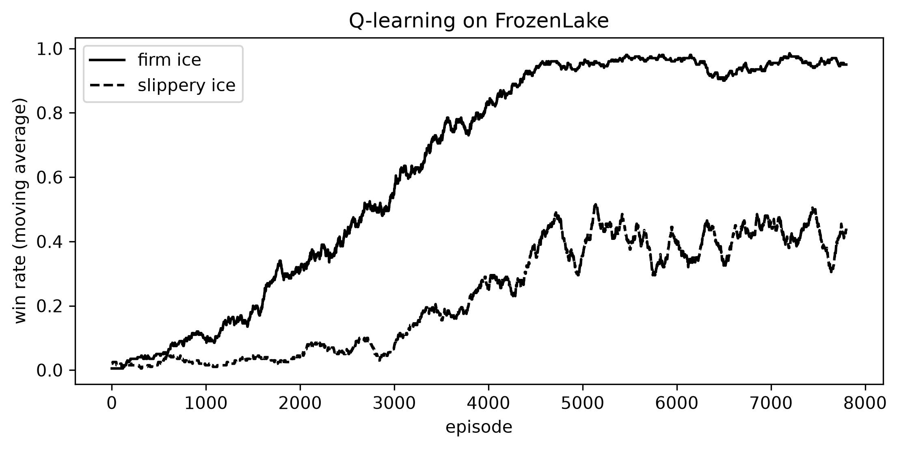

# Experiment 3: Q-learning to Play a Game (FrozenLake)

> **File:** `exp3.py`  |  **Tools:** Python 3, NumPy, Matplotlib, Gymnasium

## 🎯 Aim

To implement Q-learning in pure Python to play a game: set up the environment (OpenAI Gym), write the Q-learning algorithm and train the agent, and watch the trained agent play.

## 📘 Theory

Q-learning is a model-free, off-policy reinforcement learning algorithm. The agent keeps a table Q(s, a) of the expected discounted return of taking action a in state s and following the best actions afterwards. After each step the table entry is moved by a fraction α towards a target made of the reward and the discounted best value of the next state. Because the target uses the maximum over actions, the agent learns the optimal policy while it may behave in an exploring way. The update rule is:

OpenAI Gym was continued as Gymnasium and gives a common interface (reset and step) for many environments. Here FrozenLake is used: an agent walks on a 4 × 4 frozen lake from the start S to the goal G without falling into a hole H. There are 16 states and four actions, and the reward is 1 only at the goal. The ice may be slippery, in which case the move goes in a random direction two times out of three; this makes the problem much harder, and the agent is trained on both versions. Exploration is controlled by ε, which starts at 1 and falls to 0.05.

- **Q-table**: Table with one learned value for each state and action.
- **Off-policy**: Learns the value of the best policy while behaving differently.
- **Slippery ice**: Stochastic version in which the chosen move is not always executed.
- **ε-greedy**: Random action with probability ε, best known action otherwise.

### 📐 Formulas

$$ Q\left(s, a\right) \leftarrow Q\left(s, a\right) + \alpha \left(r + \gamma \max_{a'} Q\left(s', a'\right) - Q\left(s, a\right)\right) $$

## 🪜 Algorithm / Steps

1. Create FrozenLake-v1 with Gymnasium and print its map, states, actions and reward.
2. Write the Q-learning loop with an ε that falls during training (α = 0.2, γ = 0.95, 8000 episodes) and train on firm and on slippery ice.
3. Test the greedy policy on 500 new games on each lake.
4. Print the learned policy as arrows on the map and plot the moving average of the win rate.

## 💻 Code

```python
import re

import gymnasium as gym
import matplotlib.pyplot as plt
import numpy as np


def plain(text):
    return re.sub(r"\x1b\[[0-9;]*m", "", text)


def train(slippery, episodes=8000, seed=0):
    env = gym.make("FrozenLake-v1", is_slippery=slippery)
    rng = np.random.default_rng(seed)
    Q = np.zeros((16, 4))
    wins = []
    for ep in range(episodes):
        eps = max(0.05, 1 - ep / (episodes * 0.6))
        s, _ = env.reset(seed=int(rng.integers(1e9)))
        done = False
        while not done:
            a = int(rng.integers(4)) if rng.random() < eps else int(np.argmax(Q[s] + rng.random(4) * 1e-9))
            s2, r, term, trunc, _ = env.step(a)
            done = term or trunc
            Q[s, a] += 0.2 * (r + 0.95 * Q[s2].max() * (not term) - Q[s, a])
            s = s2
        wins.append(r)
    return env, Q, wins


def success_rate(env, Q, n=500):
    ok = 0
    for k in range(n):
        s, _ = env.reset(seed=20000 + k)
        for _ in range(100):
            s, r, term, trunc, _ = env.step(int(Q[s].argmax()))
            if term or trunc:
                ok += r
                break
    return ok / n


demo = gym.make("FrozenLake-v1", is_slippery=False, render_mode="ansi")
demo.reset(seed=0)
print("FrozenLake-v1: a 4 x 4 frozen lake; S start, F frozen, H hole, G goal")
print(plain(demo.render()))
print("states: 16   actions: 4 (left, down, right, up)   reward: 1 only at the goal\n")

results = {}
for name, slippery in (("slippery ice", True), ("firm ice", False)):
    env, Q, wins = train(slippery)
    results[name] = (Q, wins)
    print(f"{name:<13}: success rate of the greedy policy over 500 games = {success_rate(env, Q) * 100:.1f} %"
          f"   (training wins in last 1000 episodes: {int(np.sum(wins[-1000:]))})")

Q = results["firm ice"][0]
arrows = "<v>^"
print("\nlearned policy on firm ice (H = hole, G = goal)")
holes, goal = {5, 7, 11, 12}, 15
for r in range(4):
    print("  " + " ".join("H" if 4 * r + c in holes else "G" if 4 * r + c == goal else arrows[int(Q[4 * r + c].argmax())] for c in range(4)))
print("\nbest value at the start square: firm ice", round(float(Q[0].max()), 3), "| slippery ice", round(float(results["slippery ice"][0][0].max()), 3))

plt.figure(figsize=(7.5, 3.8))
for name, st in (("firm ice", "-"), ("slippery ice", "--")):
    w = np.convolve(results[name][1], np.ones(200) / 200, mode="valid")
    plt.plot(w, st, color="black", label=name)
plt.xlabel("episode"); plt.ylabel("win rate (moving average)")
plt.title("Q-learning on FrozenLake"); plt.legend()
plt.tight_layout()
plt.show()
```

## 🖥️ Output

```text
FrozenLake-v1: a 4 x 4 frozen lake; S start, F frozen, H hole, G goal

SFFF
FHFH
FFFH
HFFG

states: 16   actions: 4 (left, down, right, up)   reward: 1 only at the goal

slippery ice : success rate of the greedy policy over 500 games = 72.0 %   (training wins in last 1000 episodes: 420)
firm ice     : success rate of the greedy policy over 500 games = 100.0 %   (training wins in last 1000 episodes: 959)

learned policy on firm ice (H = hole, G = goal)
  v > v <
  v H v H
  > v v H
  H > > G

best value at the start square: firm ice 0.774 | slippery ice 0.181
```

<p align="center"></p>

## ✅ Result

On firm ice the greedy policy reaches the goal in all 500 test games (100 %) and the best value at the start square is 0.774, which is 0.95 raised to the power 5, because the reward of the goal arrives after 6 moves. On slippery ice the success rate is 72.0 % and the start value only 0.181, because even the best policy sometimes slides into a hole. The printed arrows lead around the holes at squares 5, 7, 11 and 12 to the goal.

## 🎤 Viva Questions

**Q. What is Q-learning?**  
A. A model-free reinforcement learning method that learns the value Q(s, a) of every action in every state.

**Q. What is the update rule?**  
A. Q(s, a) ← Q(s, a) + α [r + γ max Q(s′, a′) − Q(s, a)].

**Q. What are α, γ and ε?**  
A. The learning rate, the discount of future rewards and the probability of a random action.

**Q. Why is it called off-policy?**  
A. It learns the value of the best policy while it may act with a different, exploring policy.

**Q. What is OpenAI Gym or Gymnasium?**  
A. A library that gives many environments with the same reset and step interface.

---
[⬅ Back to index](README.md)
