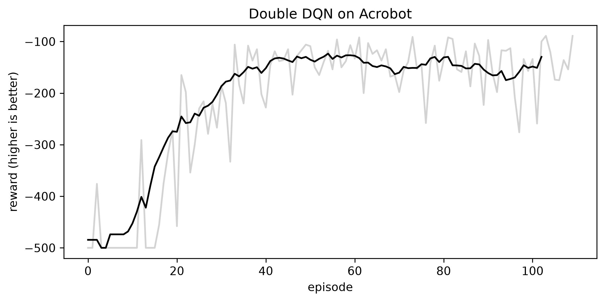

# Experiment 4: Double Deep Q-Network with PyTorch (Acrobot)

> **File:** `exp4.py`  |  **Tools:** Python 3, NumPy, Matplotlib, PyTorch, Gymnasium

## 🎯 Aim

To implement a deep Q-network with PyTorch.

## 📘 Theory

In Acrobot two linked arms hang from a joint and the agent can push the middle joint left, right or not at all. The state has six continuous numbers (the sine and cosine of both joint angles and the two angular speeds), so a Q-table is impossible and a neural network Q(s, ·) is used instead. The reward is −1 for every step until the free end swings above a line, so a good policy has a reward near −60 to −100 and a random one gets about −500.

The standard DQN is made stable by an experience replay memory (random mini-batches of past steps) and by a target network that is copied from the online network only every 250 steps. The Double DQN used here has one more improvement: the online network chooses the best next action and the target network evaluates it, which reduces the over-estimation of values that the max operator causes. The target and the loss are:

- **Experience replay**: Training on random mini-batches taken from a memory of past steps.
- **Target network**: Delayed copy of the Q-network used to compute training targets.
- **Double DQN**: Action chosen by the online network and valued by the target network.
- **Over-estimation**: Upward bias of Q-values caused by taking a maximum of noisy estimates.

### 📐 Formulas

$$ y = r + \gamma \max_{a'}{Q}_{target}\left(s', a'\right) $$

$$ L = \left(y - {Q}_{policy}\left(s, a\right)\right) $$

## 🪜 Algorithm / Steps

1. Create Acrobot-v1 and print the size of its state and the number of actions.
2. Build two 6-96-96-3 networks (online and target) and a replay memory of 30000 steps.
3. Train for 110 episodes with ε falling from 1 to 0.03, learning every second step with the Huber loss and Double DQN targets.
4. Evaluate the greedy policy for 20 episodes and plot the learning curve.

## 💻 Code

```python
import random
from collections import deque

import gymnasium as gym
import matplotlib.pyplot as plt
import numpy as np
import torch
import torch.nn as nn

random.seed(3)
np.random.seed(3)
torch.manual_seed(3)
env = gym.make("Acrobot-v1")
print("Acrobot-v1: two linked arms; swing the free end above the line")
print("state size:", env.observation_space.shape[0], " actions:", env.action_space.n, " reward: -1 per step until the goal")


def net():
    return nn.Sequential(nn.Linear(6, 96), nn.ReLU(), nn.Linear(96, 96), nn.ReLU(), nn.Linear(96, 3))


online, target = net(), net()
target.load_state_dict(online.state_dict())
opt = torch.optim.Adam(online.parameters(), lr=7e-4)
memory = deque(maxlen=30000)
gamma, batch, episodes = 0.99, 64, 110
scores = []

for ep in range(episodes):
    eps = max(0.03, 1 - ep / 60)
    s, _ = env.reset(seed=ep)
    total, done, steps = 0, False, 0
    while not done:
        if random.random() < eps:
            a = env.action_space.sample()
        else:
            with torch.no_grad():
                a = int(online(torch.tensor(s, dtype=torch.float32)).argmax())
        s2, r, term, trunc, _ = env.step(a)
        done = term or trunc
        memory.append((s, a, r, s2, float(term)))
        s, total, steps = s2, total + r, steps + 1
        if len(memory) >= 500 and steps % 2 == 0:
            S, A, R, S2, T = [torch.tensor(np.array(x), dtype=torch.float32) for x in zip(*random.sample(memory, batch))]
            q = online(S).gather(1, A.long().view(-1, 1)).squeeze()
            with torch.no_grad():
                best = online(S2).argmax(1, keepdim=True)
                y = R + gamma * target(S2).gather(1, best).squeeze() * (1 - T)
            loss = nn.functional.smooth_l1_loss(q, y)
            opt.zero_grad()
            loss.backward()
            opt.step()
        if steps % 250 == 0:
            target.load_state_dict(online.state_dict())
    scores.append(total)
    if (ep + 1) % 10 == 0:
        print(f"episode {ep + 1:>3}  average reward of last 10 = {np.mean(scores[-10:]):7.1f}  epsilon = {eps:.2f}")

test = []
for k in range(20):
    s, _ = env.reset(seed=900 + k)
    total, done = 0, False
    while not done:
        with torch.no_grad():
            s, r, term, trunc, _ = env.step(int(online(torch.tensor(s, dtype=torch.float32)).argmax()))
        done = term or trunc
        total += r
    test.append(total)
print(f"\ngreedy policy over 20 test episodes: mean reward {np.mean(test):.1f}, best {max(test):.0f}, worst {min(test):.0f}")
print(f"first 10 training episodes averaged {np.mean(scores[:10]):.1f}; a random policy needs about 500 steps")

plt.figure(figsize=(7.5, 3.8))
plt.plot(scores, color="lightgrey")
plt.plot(np.convolve(scores, np.ones(8) / 8, mode="valid"), color="black")
plt.xlabel("episode"); plt.ylabel("reward (higher is better)")
plt.title("Double DQN on Acrobot")
plt.tight_layout()
plt.show()
```

## 🖥️ Output

```text
Acrobot-v1: two linked arms; swing the free end above the line
state size: 6  actions: 3  reward: -1 per step until the goal
episode  10  average reward of last 10 =  -487.6  epsilon = 0.85
episode  20  average reward of last 10 =  -421.0  epsilon = 0.68
episode  30  average reward of last 10 =  -268.8  epsilon = 0.52
episode  40  average reward of last 10 =  -181.0  epsilon = 0.35
episode  50  average reward of last 10 =  -143.6  epsilon = 0.18
episode  60  average reward of last 10 =  -132.7  epsilon = 0.03
episode  70  average reward of last 10 =  -135.4  epsilon = 0.03
episode  80  average reward of last 10 =  -156.7  epsilon = 0.03
episode  90  average reward of last 10 =  -139.7  epsilon = 0.03
episode 100  average reward of last 10 =  -157.9  epsilon = 0.03
episode 110  average reward of last 10 =  -143.1  epsilon = 0.03

greedy policy over 20 test episodes: mean reward -96.0, best -62, worst -137
first 10 training episodes averaged -487.6; a random policy needs about 500 steps
```

<p align="center"></p>

## ✅ Result

The average reward of 10 episodes improves from −487.6 at the beginning (almost the 500-step limit) to −132.7 at episode 60 and stays between −135 and −158 while exploration is low. Without exploration the trained agent reaches a mean reward of −96.0 over 20 test episodes (best −62, worst −137), which means that it lifts the arm in about 96 steps instead of failing at 500.

## 🎤 Viva Questions

**Q. Why is a neural network used in DQN?**  
A. The state is continuous, so a table of Q-values is impossible.

**Q. What is experience replay?**  
A. Past steps are stored and random batches are used for training, which breaks the correlation of consecutive steps.

**Q. What is the target network?**  
A. A delayed copy of the Q-network that gives stable targets for the loss.

**Q. What is the exploration rate ε?**  
A. The probability of choosing a random action; it starts high and falls during training.

**Q. What is the Bellman target in DQN?**  
A. y = r + γ max Q_target(s′, a′).

---
[⬅ Back to index](README.md)
