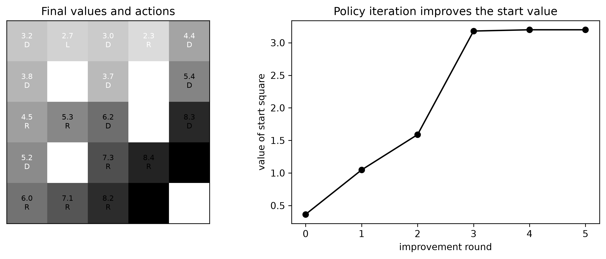

# Experiment 5: Policy Evaluation and Policy Improvement in a Gridworld

> **File:** `exp5.py`  |  **Tools:** Python 3, NumPy, Matplotlib

## 🎯 Aim

To implement iterative policy evaluation and policy update (improvement) in Python.

## 📘 Theory

A Markov decision process is defined by states, actions, transition probabilities, rewards and a discount factor γ. A policy π tells which action to take in each state, and its value function V(s) is the expected discounted return from s. Iterative policy evaluation finds V by sweeping over all states and replacing each value by the Bellman expectation: the weighted sum over the possible results of the reward plus γ times the value of the next state. The sweeps stop when the largest change is below a small θ.

Policy improvement then changes the policy in every state to the action that gives the largest one-step look-ahead value. The policy improvement theorem guarantees that the new policy is at least as good as the old one. Evaluation and improvement are repeated, which is called policy iteration, until the policy no longer changes, and then it is optimal.

The gridworld used here is 5 × 5 with three walls, a pit (reward −10) and a goal (reward +10); every other step costs −0.1. It is stochastic: the chosen move is carried out with probability 0.8 and the agent slips sideways with probability 0.1 to each side. The equations are:

- **Policy**: Rule that gives the action to take in each state.
- **Bellman expectation equation**: Value of a state written with the values of its successors.
- **Policy improvement theorem**: Acting greedily on V never gives a worse policy.
- **Slip probability**: Chance that the agent moves sideways instead of as intended.

### 📐 Formulas

$$ {V}_{\pi }\left(s\right) = \sum_{a} \pi \left(a | s\right) \left(r + \gamma V\left(s'\right)\right) $$

$$ \pi '\left(s\right) = \arg\max_{a} \left(r + \gamma V\left(s'\right)\right) $$

## 🪜 Algorithm / Steps

1. Build the 5 × 5 gridworld with walls, a pit, a goal and slipping moves.
2. Evaluate the simple policy 'go right, then down' until the largest change is below 10⁻⁶.
3. Improve the policy greedily, evaluate it again, and repeat until no action changes.
4. Print the final policy and values and plot the values and the improvement of the start value.

## 💻 Code

```python
import matplotlib.pyplot as plt
import numpy as np

ROWS, COLS = 5, 5
WALLS = {(1, 1), (2, 3), (3, 1)}
PIT, GOAL = (1, 3), (4, 4)
ACTIONS = {"U": (-1, 0), "D": (1, 0), "L": (0, -1), "R": (0, 1)}
SIDE = {"U": "LR", "D": "LR", "L": "UD", "R": "UD"}
GAMMA, SLIP = 0.9, 0.2
cells = [(r, c) for r in range(ROWS) for c in range(COLS) if (r, c) not in WALLS]


def move(s, a):
    r, c = s[0] + ACTIONS[a][0], s[1] + ACTIONS[a][1]
    return s if not (0 <= r < ROWS and 0 <= c < COLS) or (r, c) in WALLS else (r, c)


def outcomes(s, a):
    if s in (PIT, GOAL):
        return []
    res = [(1 - SLIP, move(s, a))] + [(SLIP / 2, move(s, b)) for b in SIDE[a]]
    return [(p, s2, 10.0 if s2 == GOAL else -10.0 if s2 == PIT else -0.1) for p, s2 in res]


def evaluate(policy, theta=1e-6):
    V = {s: 0.0 for s in cells}
    sweeps = 0
    while True:
        delta = 0
        for s in cells:
            v = sum(p * (r + GAMMA * V[s2]) for p, s2, r in outcomes(s, policy[s]))
            delta = max(delta, abs(v - V[s]))
            V[s] = v
        sweeps += 1
        if delta < theta:
            return V, sweeps


def improve(V):
    return {s: max(ACTIONS, key=lambda a: sum(p * (r + GAMMA * V[s2]) for p, s2, r in outcomes(s, a))) if s not in (PIT, GOAL) else "-" for s in cells}


def show(grid, fmt):
    for r in range(ROWS):
        print("  " + " ".join(fmt(r, c) for c in range(COLS)))


policy = {s: ("R" if s[1] < 4 else "D") for s in cells}
V0, sw = evaluate(policy)
start_value = V0[(0, 0)]
print(f"grid {ROWS}x{COLS}, walls {sorted(WALLS)}, pit {PIT}, goal {GOAL}, discount {GAMMA}, slip {SLIP}")
print(f"1. evaluate the simple policy 'go right, then down': {sw} sweeps, value of the start square = {start_value:.2f}")
show(V0, lambda r, c: "  ####" if (r, c) in WALLS else f"{V0[(r, c)]:6.1f}")

history = [start_value]
for it in range(1, 12):
    new = improve(V0)
    V0, sw = evaluate(new)
    changed = sum(new[s] != policy[s] for s in cells)
    policy = new
    history.append(V0[(0, 0)])
    print(f"\n2. improvement round {it}: {changed} squares changed their action, evaluation {sw} sweeps, start value {V0[(0, 0)]:.2f}")
    if changed == 0:
        break

print("\nfinal policy (# wall, P pit, G goal)")
show(policy, lambda r, c: "#" if (r, c) in WALLS else "P" if (r, c) == PIT else "G" if (r, c) == GOAL else policy[(r, c)])
print("\nfinal state values")
show(V0, lambda r, c: "  ####" if (r, c) in WALLS else f"{V0[(r, c)]:6.1f}")

fig, ax = plt.subplots(1, 2, figsize=(10, 4))
grid = np.full((ROWS, COLS), np.nan)
for s in cells:
    grid[s] = V0[s]
ax[0].imshow(grid, cmap="Greys")
for s in cells:
    ax[0].text(s[1], s[0], f"{V0[s]:.1f}" if s in (PIT, GOAL) else f"{V0[s]:.1f}\n{policy[s]}", ha="center", va="center", fontsize=8, color="white" if V0[s] < np.nanmedian(grid) else "black")
ax[0].set_title("Final values and actions"); ax[0].set_xticks([]); ax[0].set_yticks([])
ax[1].plot(range(len(history)), history, "o-", color="black")
ax[1].set_xlabel("improvement round"); ax[1].set_ylabel("value of start square")
ax[1].set_title("Policy iteration improves the start value")
plt.tight_layout()
plt.show()
```

## 🖥️ Output

```text
grid 5x5, walls [(1, 1), (2, 3), (3, 1)], pit (1, 3), goal (4, 4), discount 0.9, slip 0.2
1. evaluate the simple policy 'go right, then down': 55 sweeps, value of the start square = 0.36
     0.4    0.7    0.9    2.3    4.4
    -0.4   ####   -8.0    0.0    5.4
    -0.6   -0.8   -0.8   ####    8.3
     1.2   ####    6.6    8.4    9.6
     5.6    7.0    8.1    9.6    0.0

2. improvement round 1: 9 squares changed their action, evaluation 24 sweeps, start value 1.05

2. improvement round 2: 4 squares changed their action, evaluation 22 sweeps, start value 1.59

2. improvement round 3: 3 squares changed their action, evaluation 24 sweeps, start value 3.18

2. improvement round 4: 1 squares changed their action, evaluation 25 sweeps, start value 3.20

2. improvement round 5: 0 squares changed their action, evaluation 25 sweeps, start value 3.20

final policy (# wall, P pit, G goal)
  D L D R D
  D # D P D
  R R D # D
  D # R R D
  R R R R G

final state values
     3.2    2.7    3.0    2.3    4.4
     3.8   ####    3.7    0.0    5.4
     4.5    5.3    6.2   ####    8.3
     5.2   ####    7.3    8.4    9.6
     6.0    7.1    8.2    9.6    0.0
```

<p align="center"></p>

## ✅ Result

The simple policy needs 55 sweeps and gives the start square a value of only 0.36, and it walks the agent next to the pit (value −8.0 beside it). Policy iteration changes 9, 4, 3 and 1 actions in the first four rounds and is stable after the fifth round, with the start value rising from 0.36 to 1.05, 1.59, 3.18 and finally 3.20. The final policy steers around the pit and the walls towards the goal, and the values grow from about 3 at the start to 9.6 next to the goal.

## 🎤 Viva Questions

**Q. What is policy evaluation?**  
A. Finding the value V(s) of every state when a given policy is followed.

**Q. What is the Bellman expectation equation?**  
A. The value of a state equals the expected reward plus the discounted value of the next state.

**Q. What is policy improvement?**  
A. Making the policy greedy with respect to the current values.

**Q. What is policy iteration?**  
A. Repeating evaluation and improvement until the policy no longer changes.

**Q. When does the evaluation stop?**  
A. When the largest change of a value in one sweep is below a small number θ.

---
[⬅ Back to index](README.md)
