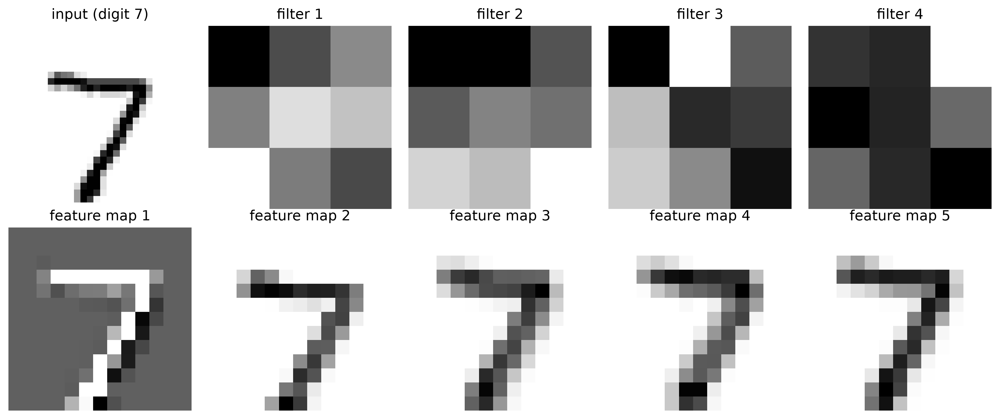

# Experiment 7: MNIST Classification with a CNN in PyTorch

> **File:** `exp7.py`  |  **Tools:** Python 3, NumPy, Matplotlib, PyTorch, Keras (data loader)

## 🎯 Aim

To classify the images of the MNIST data set with a CNN that has a fully connected layer.

## 📘 Theory

MNIST holds 70000 images of handwritten digits (60000 for training and 10000 for testing), each 28 × 28 pixels in grey levels. A convolutional network exploits the structure of images in two ways: a filter has few weights and is slid over the whole picture (weight sharing), and pooling makes the result slightly insensitive to small shifts. The first convolution layer learns simple filters such as edges and strokes, and the later layers combine them into parts of digits.

The network here has two convolution layers (8 and 16 filters of size 3 × 3, each with ReLU and 2 × 2 max pooling) which turn the image into 16 maps of 5 × 5. These 400 numbers are flattened and passed to the fully connected part: a dense layer of 64 units with dropout, and a final layer of 10 units, one for each digit. It is trained with Adam and a learning rate that is halved every two epochs. At the end the learned filters and the feature maps of one image are drawn.

- **Weight sharing**: The same filter weights are used at every position of the image.
- **Feature map**: Output of one filter over the whole image.
- **Flatten**: Rearranges the maps into one long vector.
- **Learning-rate schedule**: Plan that lowers the learning rate during training.

### 📐 Formulas

$$ (I \ast K)\left(i, j\right) = \sum_{m, n} I\left(i + m, j + n\right)K\left(m, n\right) $$

$$ loss = - \sum_{c} {y}_{c} \log {p}_{c} $$

## 🪜 Algorithm / Steps

1. Load MNIST and convert the images to PyTorch tensors scaled to 0–1.
2. Build Conv(8) → ReLU → Pool → Conv(16) → ReLU → Pool → Flatten → Dense(64) → Dropout → Dense(10).
3. Train for 4 epochs with Adam and a step learning-rate schedule and test after every epoch.
4. Calculate the accuracy of every digit and count the mistakes.
5. Draw the input digit, four learned filters and five feature maps.

## 💻 Code

```python
import os
os.environ["TF_CPP_MIN_LOG_LEVEL"] = "3"
import time

import keras
import matplotlib.pyplot as plt
import numpy as np
import torch
import torch.nn as nn

torch.manual_seed(7)
(xtr, ytr), (xte, yte) = keras.datasets.mnist.load_data()
Xtr = torch.tensor(xtr / 255.0, dtype=torch.float32).unsqueeze(1)
Xte = torch.tensor(xte / 255.0, dtype=torch.float32).unsqueeze(1)
Ytr, Yte = torch.tensor(ytr).long(), torch.tensor(yte).long()
print("training set", tuple(Xtr.shape), " test set", tuple(Xte.shape))

conv = nn.Sequential(nn.Conv2d(1, 8, 3), nn.ReLU(), nn.MaxPool2d(2), nn.Conv2d(8, 16, 3), nn.ReLU(), nn.MaxPool2d(2))
head = nn.Sequential(nn.Flatten(), nn.Linear(16 * 5 * 5, 64), nn.ReLU(), nn.Dropout(0.25), nn.Linear(64, 10))
model = nn.Sequential(conv, head)
print("feature extractor output:", tuple(conv(Xtr[:1]).shape[1:]), "-> flattened 400 -> dense 64 -> 10 classes")
print("trainable parameters:", sum(p.numel() for p in model.parameters()))

opt = torch.optim.Adam(model.parameters(), lr=2e-3)
sched = torch.optim.lr_scheduler.StepLR(opt, step_size=2, gamma=0.5)
t0 = time.time()
curve = []
for ep in range(1, 5):
    model.train()
    perm = torch.randperm(len(Xtr))
    for i in range(0, len(perm), 128):
        b = perm[i:i + 128]
        loss = nn.functional.cross_entropy(model(Xtr[b]), Ytr[b])
        opt.zero_grad()
        loss.backward()
        opt.step()
    sched.step()
    model.eval()
    with torch.no_grad():
        acc = (torch.cat([model(Xte[i:i + 1000]).argmax(1) for i in range(0, 10000, 1000)]) == Yte).float().mean().item()
    curve.append(acc)
    print(f"epoch {ep}: learning rate {opt.param_groups[0]['lr']:.4f}, last loss {loss.item():.4f}, test accuracy {acc * 100:.2f} %")
print(f"training time {time.time() - t0:.0f} s")

with torch.no_grad():
    pred = torch.cat([model(Xte[i:i + 1000]).argmax(1) for i in range(0, 10000, 1000)])
per_digit = [(pred[Yte == d] == d).float().mean().item() * 100 for d in range(10)]
print("accuracy per digit:", " ".join(f"{d}:{a:.1f}" for d, a in enumerate(per_digit)))
print("total mistakes:", int((pred != Yte).sum()), "of 10000")

sample = Xte[0:1]
with torch.no_grad():
    maps = conv[:3](sample)[0]
fig, ax = plt.subplots(2, 5, figsize=(12, 5))
ax[0, 0].imshow(sample[0, 0], cmap="Greys"); ax[0, 0].set_title(f"input (digit {yte[0]})")
filters = conv[0].weight.detach()[:, 0]
for k in range(4):
    ax[0, k + 1].imshow(filters[k], cmap="Greys"); ax[0, k + 1].set_title(f"filter {k + 1}")
for k in range(5):
    ax[1, k].imshow(maps[k], cmap="Greys"); ax[1, k].set_title(f"feature map {k + 1}")
for a in ax.ravel():
    a.axis("off")
plt.tight_layout()
plt.show()
```

## 🖥️ Output

```text
training set (60000, 1, 28, 28)  test set (10000, 1, 28, 28)
feature extractor output: (16, 5, 5) -> flattened 400 -> dense 64 -> 10 classes
trainable parameters: 27562
epoch 1: learning rate 0.0020, last loss 0.2406, test accuracy 96.61 %
epoch 2: learning rate 0.0010, last loss 0.1735, test accuracy 97.59 %
epoch 3: learning rate 0.0010, last loss 0.0972, test accuracy 97.94 %
epoch 4: learning rate 0.0005, last loss 0.0450, test accuracy 98.31 %
training time 29 s
accuracy per digit: 0:99.2 1:99.4 2:98.7 3:97.8 4:98.7 5:98.5 6:98.6 7:98.5 8:96.0 9:97.4
total mistakes: 169 of 10000
```

<p align="center"></p>

## ✅ Result

The network has only 27562 parameters, yet the test accuracy rises from 96.61 % after the first epoch to 98.31 % after the fourth, which is 169 mistakes in 10000 images, and the training takes about half a minute. Digits 1 (99.4 %) and 0 (99.2 %) are easiest, and 8 (96.0 %) and 9 (97.4 %) are the hardest. The drawn feature maps show that the filters respond to strokes and edges of the digit.

## 🎤 Viva Questions

**Q. What is MNIST?**  
A. A data set of 70000 handwritten digit images of 28 × 28 pixels.

**Q. What does a convolution layer learn?**  
A. Filters that detect local patterns such as edges and strokes.

**Q. What is the role of the fully connected layer?**  
A. It combines the extracted features to give a score for each digit.

**Q. What is dropout?**  
A. Randomly switching off units during training to reduce over-fitting.

**Q. Which loss is used for classification?**  
A. The cross-entropy loss with a softmax output.

---
[⬅ Back to index](README.md)
