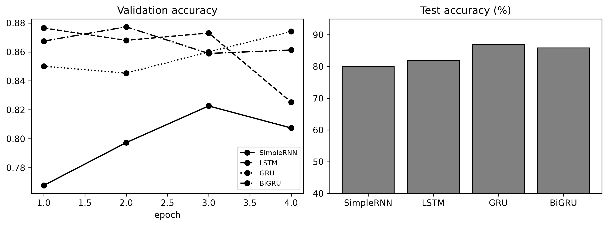

# Experiment 8: Sentiment Analysis on IMDB: SimpleRNN, LSTM and GRU

> **File:** `exp8.py`  |  **Tools:** Python 3, NumPy, Matplotlib, TensorFlow / Keras, scikit-learn

## 🎯 Aim

To train a sentiment analysis model on the IMDB data set using RNN layers with LSTM and GRU cells.

## 📘 Theory

Sentiment analysis classifies a review as positive or negative. The 50000 IMDB reviews are split equally into training and test sets, and each review is cut or padded to 250 words from a vocabulary of 8000. An embedding layer turns each word into a vector of 32 numbers, and a recurrent layer reads these vectors one at a time and keeps a state that summarises the text so far.

A simple RNN has trouble remembering information over a long review, because the gradient fades while it flows back through many steps. The LSTM solves this with a separate cell state and three gates (forget, input and output) that decide what to erase, add and show, and the GRU is a lighter cell with two gates. A bi-directional GRU reads the review in both directions. All four models are trained with the same data, with gradient clipping, and compared. The LSTM equations are:

- **Vanishing gradient**: Fading of the learning signal over many time steps.
- **Gate**: Learned value between 0 and 1 that lets information through or blocks it.
- **Gradient clipping**: Limiting the size of the gradient to keep training stable.
- **Bi-directional layer**: Runs one recurrent layer forwards and one backwards over the text.

### 📐 Formulas

$$ {f}_{t} = \sigma \left({W}_{f}\left({h}_{t-1}, {x}_{t}\right) + {b}_{f}\right) $$

$$ {c}_{t} = {f}_{t} \odot {c}_{t-1} + {i}_{t} \odot {\tilde{c}}_{t} $$

$$ {h}_{t} = {o}_{t} \odot \tanh \left({c}_{t}\right) $$

## 🪜 Algorithm / Steps

1. Load IMDB with a vocabulary of 8000 words and pad every review to 250 words.
2. Build Embedding → recurrent layer → Dropout → Dense(sigmoid) for SimpleRNN, LSTM, GRU and bi-directional GRU.
3. Train each for 4 epochs with Adam (learning rate 0.002, clip norm 1) and record validation and test accuracy and training time.
4. Print the confusion matrix, precision and recall of the best model and plot the validation accuracy.

## 💻 Code

```python
import os
os.environ["TF_CPP_MIN_LOG_LEVEL"] = "3"
import time

import keras
import matplotlib.pyplot as plt
import numpy as np
from keras import layers
from sklearn.metrics import confusion_matrix

keras.utils.set_random_seed(8)
VOCAB, LEN = 8000, 250
(xtr, ytr), (xte, yte) = keras.datasets.imdb.load_data(num_words=VOCAB)
xtr, xte = keras.utils.pad_sequences(xtr, maxlen=LEN), keras.utils.pad_sequences(xte, maxlen=LEN)
lengths = [len(s) for s in keras.datasets.imdb.load_data(num_words=VOCAB)[0][0]]
print(f"{len(xtr)} training reviews, {len(xte)} test reviews; average review {np.mean(lengths):.0f} words, cut or padded to {LEN}")


def build(kind):
    cell = {"SimpleRNN": layers.SimpleRNN(32), "LSTM": layers.LSTM(32), "GRU": layers.GRU(32), "BiGRU": layers.Bidirectional(layers.GRU(24))}[kind]
    return keras.Sequential([keras.layers.Input((LEN,)), layers.Embedding(VOCAB, 32, mask_zero=True), cell,
                             layers.Dropout(0.3), layers.Dense(1, activation="sigmoid")])


rows = {}
for kind in ("SimpleRNN", "LSTM", "GRU", "BiGRU"):
    m = build(kind)
    m.compile(optimizer=keras.optimizers.Adam(2e-3, clipnorm=1.0), loss="binary_crossentropy", metrics=["accuracy"])
    t0 = time.time()
    h = m.fit(xtr, ytr, epochs=4, batch_size=128, validation_split=0.15, verbose=0)
    acc = m.evaluate(xte, yte, verbose=0)[1]
    rows[kind] = (m.count_params(), h.history["val_accuracy"], acc, time.time() - t0, m)
    print(f"{kind:<10} parameters {m.count_params():>6}  validation accuracy by epoch {[round(v, 3) for v in h.history['val_accuracy']]}  test accuracy {acc * 100:.2f} %  time {time.time() - t0:.0f} s")

best = max(rows, key=lambda k: rows[k][2])
print("\nbest model on the test reviews:", best)
pred = (rows[best][4].predict(xte, verbose=0).ravel() > 0.5).astype(int)
cm = confusion_matrix(yte, pred)
print("confusion matrix [[true negative, false positive], [false negative, true positive]]")
print(cm)
print(f"precision {cm[1, 1] / cm[:, 1].sum():.3f}  recall {cm[1, 1] / cm[1].sum():.3f}")

fig, ax = plt.subplots(1, 2, figsize=(10, 3.8))
for kind, st in zip(rows, ("-", "--", ":", "-.")):
    ax[0].plot(range(1, 5), rows[kind][1], st, marker="o", color="black", label=kind)
ax[0].set_title("Validation accuracy"); ax[0].set_xlabel("epoch"); ax[0].legend(fontsize=8)
ax[1].bar(list(rows), [rows[k][2] * 100 for k in rows], color="grey", edgecolor="black")
ax[1].set_ylim(40, 95); ax[1].set_title("Test accuracy (%)")
plt.tight_layout()
plt.show()
```

## 🖥️ Output

```text
25000 training reviews, 25000 test reviews; average review 239 words, cut or padded to 250
SimpleRNN  parameters 258113  validation accuracy by epoch [0.768, 0.797, 0.823, 0.807]  test accuracy 80.09 %  time 19 s
LSTM       parameters 264353  validation accuracy by epoch [0.877, 0.868, 0.873, 0.825]  test accuracy 81.94 %  time 28 s
GRU        parameters 262369  validation accuracy by epoch [0.85, 0.845, 0.86, 0.874]  test accuracy 86.99 %  time 31 s
BiGRU      parameters 264401  validation accuracy by epoch [0.867, 0.877, 0.859, 0.861]  test accuracy 85.88 %  time 46 s

best model on the test reviews: GRU
confusion matrix [[true negative, false positive], [false negative, true positive]]
[[10513  1987]
 [ 1265 11235]]
precision 0.850  recall 0.899
```

<p align="center"></p>

## ✅ Result

On the test reviews the GRU is best with 86.99 %, followed by the bi-directional GRU (85.88 %), the LSTM (81.94 %) and the SimpleRNN (80.09 %). The LSTM reached 87.7 % on the validation data in the first epoch but then lost accuracy as it began to over-fit, so a smaller number of epochs or early stopping would suit it. The best model has precision 0.850 and recall 0.899 for positive reviews. These numbers change a little from run to run.

## 🎤 Viva Questions

**Q. Why an LSTM or GRU instead of a simple RNN?**  
A. They have gates that keep information over long texts, while a simple RNN suffers from the vanishing gradient.

**Q. What are the gates of an LSTM?**  
A. The forget, input and output gates that control a cell state.

**Q. How does a GRU differ?**  
A. It is lighter and has only two gates.

**Q. What is padding?**  
A. Making all reviews the same length by adding zeros or cutting.

**Q. What is the IMDB data set?**  
A. 50000 movie reviews labelled positive or negative.

---
[⬅ Back to index](README.md)
