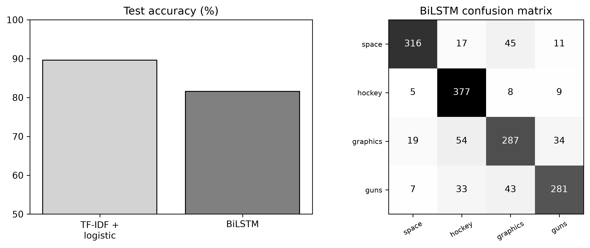

# Experiment 9: Deep Learning in NLP: Topic Classification of Posts

> **File:** `exp9.py`  |  **Tools:** Python 3, NumPy, Matplotlib, TensorFlow / Keras, scikit-learn

## 🎯 Aim

To apply a deep learning model in the field of natural language processing and compare it with a classical baseline.

## 📘 Theory

Text classification is a typical NLP task: a post is assigned to a topic. The classical approach turns each text into a TF-IDF vector, in which every word is weighted by how often it occurs in the post and how rare it is in all posts, and then fits a linear classifier such as logistic regression. It is fast and a strong baseline. The deep approach learns an embedding for each word, reads the sequence with a bi-directional LSTM and classifies from the pooled states.

The 20 Newsgroups collection is used with four topics (space, hockey, computer graphics and gun politics). The e-mail headers, footers and quoted text are removed so that the models have to read the content. After training, the learned word embedding is inspected: words that the network places close together should be related in meaning.

- **TF-IDF**: Weight that is high for words frequent in a post but rare overall.
- **Word embedding**: Learned vector in which similar words are close.
- **Baseline**: Simple model that a more complex model has to beat.
- **Cosine similarity**: Measure of the angle between two vectors, used for word similarity.

## 🪜 Algorithm / Steps

1. Load four topics of 20 Newsgroups without headers, footers and quotes.
2. Train a TF-IDF plus logistic regression baseline and measure its test accuracy.
3. Train Embedding → Bidirectional LSTM → global max pooling → Dense for 5 epochs on posts cut to 200 words.
4. Compare the two accuracies, print the confusion matrix and find the nearest words to nasa, hockey, graphics and gun in the learned embedding.

## 💻 Code

```python
import os
os.environ["TF_CPP_MIN_LOG_LEVEL"] = "3"
import re
import time

import keras
import matplotlib.pyplot as plt
import numpy as np
from keras import layers
from sklearn.datasets import fetch_20newsgroups
from sklearn.feature_extraction.text import TfidfVectorizer
from sklearn.linear_model import LogisticRegression
from sklearn.metrics import accuracy_score, confusion_matrix

keras.utils.set_random_seed(9)
cats = ["sci.space", "rec.sport.hockey", "comp.graphics", "talk.politics.guns"]
strip = ("headers", "footers", "quotes")
tr = fetch_20newsgroups(subset="train", categories=cats, remove=strip)
te = fetch_20newsgroups(subset="test", categories=cats, remove=strip)
print("topics:", cats)
print("training posts:", len(tr.data), " test posts:", len(te.data), " average length:", int(np.mean([len(d.split()) for d in tr.data])), "words")

t0 = time.time()
tfidf = TfidfVectorizer(max_features=20000, stop_words="english")
base = LogisticRegression(max_iter=1000).fit(tfidf.fit_transform(tr.data), tr.target)
base_pred = base.predict(tfidf.transform(te.data))
base_acc = accuracy_score(te.target, base_pred)
print(f"\nbaseline TF-IDF + logistic regression: test accuracy {base_acc * 100:.2f} %  ({time.time() - t0:.1f} s)")

vec = layers.TextVectorization(max_tokens=15000, output_sequence_length=200)
vec.adapt(np.array(tr.data))
Xtr, Xte = vec(np.array(tr.data)).numpy(), vec(np.array(te.data)).numpy()
model = keras.Sequential([
    keras.layers.Input((200,)),
    layers.Embedding(15000, 64, mask_zero=True),
    layers.Bidirectional(layers.LSTM(48, return_sequences=True)),
    layers.GlobalMaxPooling1D(),
    layers.Dropout(0.4),
    layers.Dense(len(cats), activation="softmax"),
])
model.compile(optimizer=keras.optimizers.Adam(2e-3), loss="sparse_categorical_crossentropy", metrics=["accuracy"])
t0 = time.time()
hist = model.fit(Xtr, tr.target, epochs=5, batch_size=64, validation_split=0.1, verbose=0)
pred = model.predict(Xte, verbose=0).argmax(axis=1)
acc = accuracy_score(te.target, pred)
print(f"embedding + bidirectional LSTM ({model.count_params()} parameters): test accuracy {acc * 100:.2f} %  ({time.time() - t0:.0f} s)")
for e, (a, v) in enumerate(zip(hist.history["accuracy"], hist.history["val_accuracy"]), 1):
    print(f"  epoch {e}: train accuracy {a:.3f}  validation accuracy {v:.3f}")

emb = model.layers[0].get_weights()[0]
vocab = vec.get_vocabulary()
index = {w: i for i, w in enumerate(vocab)}


def neighbours(word, k=4):
    v = emb[index[word]]
    sims = emb @ v / (np.linalg.norm(emb, axis=1) * np.linalg.norm(v) + 1e-9)
    return [str(vocab[i]) for i in np.argsort(-sims)[1:k + 1]]


print("\nwords closest to some topic words in the learned embedding")
for w in ("nasa", "hockey", "graphics", "gun"):
    if w in index:
        print(f"  {w:<9}->", neighbours(w))

cm = confusion_matrix(te.target, pred)
print("\nconfusion matrix of the LSTM model (rows = true topic)")
print(cm)

fig, ax = plt.subplots(1, 2, figsize=(10, 4))
ax[0].bar(["TF-IDF +\nlogistic", "BiLSTM"], [base_acc * 100, acc * 100], color=["lightgrey", "grey"], edgecolor="black")
ax[0].set_ylim(50, 100); ax[0].set_title("Test accuracy (%)")
ax[1].imshow(cm, cmap="Greys")
ax[1].set_xticks(range(4)); ax[1].set_xticklabels([c.split(".")[-1] for c in cats], rotation=30, fontsize=8)
ax[1].set_yticks(range(4)); ax[1].set_yticklabels([c.split(".")[-1] for c in cats], fontsize=8)
for i in range(4):
    for j in range(4):
        ax[1].text(j, i, cm[i, j], ha="center", va="center", color="white" if cm[i, j] > cm.max() / 2 else "black")
ax[1].set_title("BiLSTM confusion matrix")
plt.tight_layout()
plt.show()
```

## 🖥️ Output

```text
topics: ['sci.space', 'rec.sport.hockey', 'comp.graphics', 'talk.politics.guns']
training posts: 2323  test posts: 1546  average length: 194 words

baseline TF-IDF + logistic regression: test accuracy 89.59 %  (0.3 s)
embedding + bidirectional LSTM (1003780 parameters): test accuracy 81.57 %  (9 s)
  epoch 1: train accuracy 0.407  validation accuracy 0.416
  epoch 2: train accuracy 0.636  validation accuracy 0.790
  epoch 3: train accuracy 0.844  validation accuracy 0.811
  epoch 4: train accuracy 0.926  validation accuracy 0.858
  epoch 5: train accuracy 0.942  validation accuracy 0.858

words closest to some topic words in the learned embedding
  nasa     -> ['telescope', 'scispace', 'pads', 'theoretical']
  hockey   -> ['games', 'montreal', 'scored', 'league']
  graphics -> ['3d', 'computer', 'compgraphics', 'format']
  gun      -> ['batf', 'waco', 'koresh', 'tear']

confusion matrix of the LSTM model (rows = true topic)
[[316  17  45  11]
 [  5 377   8   9]
 [ 19  54 287  34]
 [  7  33  43 281]]
```

<p align="center"></p>

## ✅ Result

The data has 2323 training and 1546 test posts. The simple TF-IDF baseline scores 89.59 % in 0.3 s, while the bi-directional LSTM (about one million parameters, mostly in the embedding) scores 81.57 % after 9 s; training accuracy reaches 94 % but the validation accuracy stays at 86 %, so it over-fits this small corpus. The classical model therefore wins here, which is an honest reminder that deep models need more data. The embedding is still meaningful: 'nasa' is close to telescope and scispace, 'hockey' to games, montreal and league, and 'gun' to batf and waco. The LSTM confuses graphics with hockey and guns most often.

## 🎤 Viva Questions

**Q. What is a language model?**  
A. A model that predicts the next token from the tokens before it.

**Q. What does the temperature do when generating text?**  
A. A low value gives safe and repetitive text, a high value gives varied and less correct text.

**Q. What is perplexity?**  
A. e raised to the cross-entropy loss; the average number of equally likely choices of the model.

**Q. What is gradient clipping?**  
A. Limiting the size of the gradient to keep training stable.

**Q. Why is text turned into numbers?**  
A. Neural networks work with numbers, so words or characters are mapped to vectors.

---
[⬅ Back to index](README.md)
