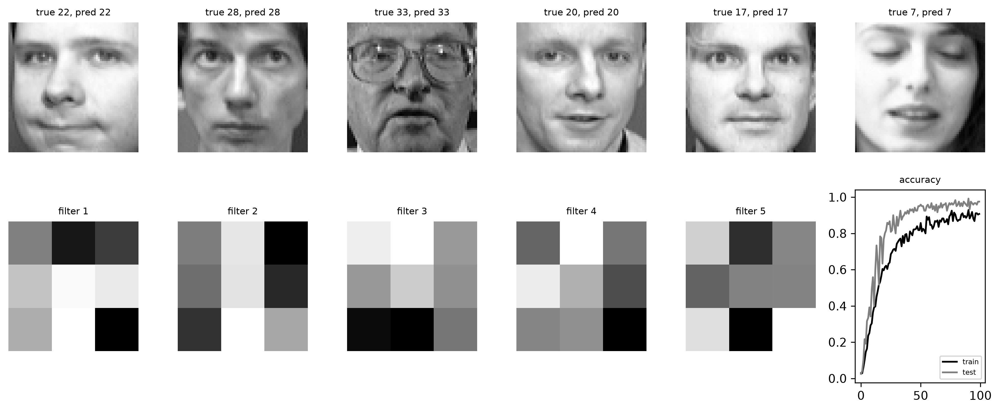

# Experiment 10: CNN for Face Recognition on the Olivetti Faces

> **File:** `exp10.py`  |  **Tools:** Python 3, NumPy, Matplotlib, TensorFlow / Keras, scikit-learn

## 🎯 Aim

To apply a convolutional neural network on a computer vision problem.

## 📘 Theory

Face recognition is a computer vision problem in which an image is assigned to one of several known people. The Olivetti data set contains 400 grey images of size 64 × 64: ten different photos of each of 40 people, taken with different expressions, lighting and glasses. This is very little data for a neural network, so over-fitting is the main danger.

Three things are done against it. Data augmentation applies random shifts, rotations, zoom and contrast changes to every training image in every epoch, so the network never sees exactly the same picture twice. Dropout removes units at random during training. And the network is kept small: three convolution and pooling blocks, then a dense layer. Seven photos of each person are used for training and the remaining three for testing, so the test set contains new photos of the same people.

- **Data augmentation**: Random transformations that create new training images.
- **Over-fitting**: Remembering the training images instead of learning the person.
- **Top-5 accuracy**: Share of cases in which the right class is among the five best guesses.
- **Dropout**: Randomly switching units off during training.

## 🪜 Algorithm / Steps

1. Load the 400 Olivetti faces and split them 70:30 with every person in both parts.
2. Subtract the mean image value and build a pipeline of random translation, rotation, zoom and contrast layers.
3. Build three Conv-Pool blocks, Flatten, Dropout, Dense(128), Dropout and Dense(40, softmax).
4. Train for 100 epochs and print the accuracy at several epochs.
5. Calculate the test and top-5 accuracy, list the mistakes and draw test faces, learned filters and the accuracy curve.

## 💻 Code

```python
import os
os.environ["TF_CPP_MIN_LOG_LEVEL"] = "3"
import keras
import matplotlib.pyplot as plt
import numpy as np
from keras import layers
from sklearn.datasets import fetch_olivetti_faces
from sklearn.model_selection import train_test_split

keras.utils.set_random_seed(10)
faces = fetch_olivetti_faces()
X = faces.images[..., None].astype("float32")
y = faces.target
print(f"Olivetti faces: {len(X)} images of {len(set(y))} people ({len(X) // len(set(y))} each), size {X.shape[1]} x {X.shape[2]}")
Xtr, Xte, ytr, yte = train_test_split(X, y, test_size=0.3, stratify=y, random_state=4)
mean = Xtr.mean()
Xtr, Xte = Xtr - mean, Xte - mean
print("training images:", len(Xtr), " test images:", len(Xte), "(unseen photos of the same people)")

aug = keras.Sequential([layers.RandomTranslation(0.08, 0.08), layers.RandomRotation(0.06), layers.RandomZoom(0.1), layers.RandomContrast(0.15)])
inputs = keras.Input((64, 64, 1))
x = aug(inputs)
for f in (16, 32, 64):
    x = layers.Conv2D(f, 3, padding="same", activation="relu")(x)
    x = layers.MaxPooling2D()(x)
x = layers.Flatten()(x)
x = layers.Dropout(0.5)(x)
x = layers.Dense(128, activation="relu")(x)
x = layers.Dropout(0.3)(x)
outputs = layers.Dense(40, activation="softmax")(x)
model = keras.Model(inputs, outputs)
model.compile(optimizer=keras.optimizers.Adam(1e-3), loss="sparse_categorical_crossentropy", metrics=["accuracy"])
print("parameters:", model.count_params())

hist = model.fit(Xtr, ytr, validation_data=(Xte, yte), epochs=100, batch_size=32, verbose=0)
for e in (9, 24, 49, 74, 99):
    print(f"epoch {e + 1:>2}: train accuracy {hist.history['accuracy'][e]:.3f}  test accuracy {hist.history['val_accuracy'][e]:.3f}")

probs = model.predict(Xte, verbose=0)
pred = probs.argmax(1)
acc = (pred == yte).mean()
print(f"\nfinal test accuracy {acc * 100:.2f} %  ({int((pred != yte).sum())} wrong out of {len(yte)})")
top5 = np.mean([yte[i] in np.argsort(probs[i])[::-1][:5] for i in range(len(yte))])
print(f"correct person among the top five guesses: {top5 * 100:.1f} %")
wrong = np.where(pred != yte)[0]
for i in wrong[:6]:
    print(f"  photo of person {yte[i]:>2} taken for person {pred[i]:>2} (confidence {probs[i].max():.2f})")

fig, ax = plt.subplots(2, 6, figsize=(12, 5.2))
ax = ax.ravel()
for k in range(6):
    ax[k].imshow(Xte[k, :, :, 0] + mean, cmap="gray")
    ax[k].set_title(f"true {yte[k]}, pred {pred[k]}", fontsize=8)
for k in range(5):
    ax[6 + k].imshow(model.layers[2].get_weights()[0][:, :, 0, k], cmap="gray")
    ax[6 + k].set_title(f"filter {k + 1}", fontsize=8)
ax[11].plot(hist.history["accuracy"], color="black", label="train")
ax[11].plot(hist.history["val_accuracy"], color="grey", label="test")
ax[11].set_title("accuracy", fontsize=8); ax[11].legend(fontsize=6)
for a in ax[:11]:
    a.axis("off")
plt.tight_layout()
plt.show()
```

## 🖥️ Output

```text
Olivetti faces: 400 images of 40 people (10 each), size 64 x 64
training images: 280  test images: 120 (unseen photos of the same people)
parameters: 552872
epoch 10: train accuracy 0.304  test accuracy 0.492
epoch 25: train accuracy 0.639  test accuracy 0.867
epoch 50: train accuracy 0.818  test accuracy 0.950
epoch 75: train accuracy 0.893  test accuracy 0.967
epoch 100: train accuracy 0.907  test accuracy 0.975

final test accuracy 97.50 %  (3 wrong out of 120)
correct person among the top five guesses: 100.0 %
  photo of person  9 taken for person 34 (confidence 0.31)
  photo of person 38 taken for person 32 (confidence 0.95)
  photo of person 34 taken for person 20 (confidence 0.93)
```

<p align="center"></p>

## ✅ Result

The network (552872 parameters) learns from only 280 images and reaches a test accuracy of 97.5 % (3 mistakes in 120 photos), with the correct person always among the top five guesses. The test accuracy rises from 49.2 % at epoch 10 to 86.7 % at epoch 25 and 97.5 % at epoch 100, while the training accuracy is lower (90.7 %) because it is measured on augmented images. An earlier version with batch normalisation reached only 44 % on this tiny data set and had to be changed.

## 🎤 Viva Questions

**Q. Which problem was solved?**  
A. Classifying images with a convolutional neural network.

**Q. What is batch normalisation?**  
A. It rescales the outputs of a layer for every mini-batch and speeds up training.

**Q. What is data augmentation?**  
A. Creating new training images by random shifts, rotations, flips or zoom.

**Q. What does a confusion matrix show?**  
A. Which classes are mistaken for which.

**Q. What is over-fitting?**  
A. The network remembers the training images and does badly on new ones.

---
[⬅ Back to index](README.md)
