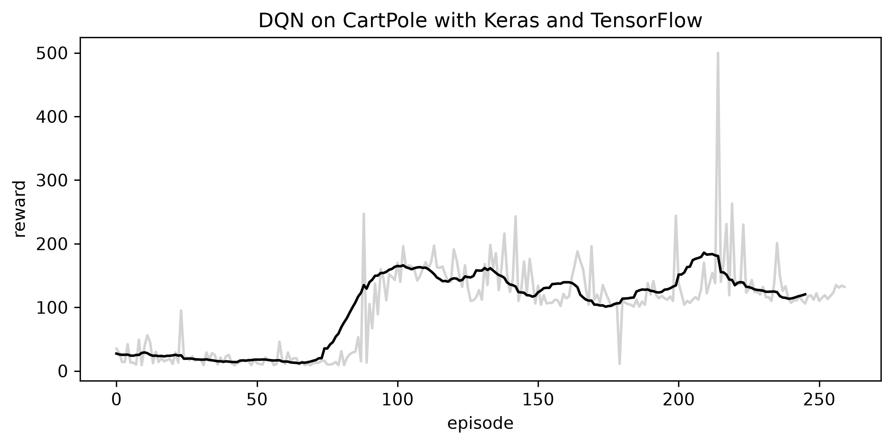

# Experiment 11: DQN for the CartPole Problem with Keras and TensorFlow

> **File:** `exp11.py`  |  **Tools:** Python 3, NumPy, Matplotlib, TensorFlow / Keras, Gymnasium

## 🎯 Aim

To implement Deep Q-Networks for the CartPole problem, in which an agent balances a pole on a cart, using Keras and TensorFlow.

## 📘 Theory

CartPole is the standard first problem of deep reinforcement learning. The agent sees four numbers (cart position and speed, pole angle and angular speed) and chooses one of two actions, push left or push right. Every step with the pole up gives +1, and an episode stops when the pole leans more than 12 degrees, the cart leaves the track or 500 steps are reached.

A deep Q-network (DQN) uses a neural network in place of the Q-table. The network takes the state and returns one value for each action; the agent mostly picks the action with the largest value and sometimes (with probability ε) a random one. Learning uses the Bellman target y = r + γ max Q_target(s′, a′), and the loss between y and the network's own value is minimised with gradient descent. A replay memory and a periodically refreshed target network are needed because otherwise the targets move while they are being learnt.

This version is written with the Keras layers and a tf.function training step in TensorFlow, which compiles the update into a fast graph. The loss is the Huber loss, which is less sensitive to a large error than the squared error. The network is small (two layers of 64 units), the target network is copied every 400 steps and the discount is 0.98.

- **tf.function**: TensorFlow decorator that compiles a Python function into a graph.
- **Huber loss**: Squared error for small errors, absolute error for large ones.
- **Discount γ**: Weight of future rewards; 0.98 looks about 50 steps ahead.
- **Replay memory**: Buffer of past steps from which random batches are drawn.

### 📐 Formulas

$$ y = r + \gamma \max_{a'}{Q}_{target}\left(s', a'\right) $$

$$ L = \left(y - {Q}_{policy}\left(s, a\right)\right) $$

## 🪜 Algorithm / Steps

1. Create CartPole-v1 and print its state, action and termination rules.
2. Build the Q-network with Keras (4 → 64 → 64 → 2) and a copy as the target network.
3. Write train_step with tf.function: the Bellman target, the Huber loss and the optimiser update.
4. Play 260 episodes with ε falling from 1 to 0.03, store every step, learn after every step and refresh the target every 400 steps.
5. Evaluate the greedy policy on 20 new episodes and plot the rewards.

## 💻 Code

```python
import os
os.environ["TF_CPP_MIN_LOG_LEVEL"] = "3"
import random
from collections import deque

import gymnasium as gym
import keras
import matplotlib.pyplot as plt
import numpy as np
import tensorflow as tf

keras.utils.set_random_seed(11)
random.seed(11)
env = gym.make("CartPole-v1")
print("CartPole-v1 | state:", env.observation_space.shape[0], "numbers | actions:", env.action_space.n, "(push left, push right)")
print("an episode ends when the pole tilts more than 12 degrees, the cart leaves the track or 500 steps pass")


def build():
    return keras.Sequential([
        keras.layers.Input((4,)),
        keras.layers.Dense(64, activation="relu"),
        keras.layers.Dense(64, activation="relu"),
        keras.layers.Dense(2),
    ])


model, target = build(), build()
target.set_weights(model.get_weights())
optimizer = keras.optimizers.Adam(1e-3)
huber = keras.losses.Huber()
GAMMA, BATCH = 0.98, 64


@tf.function
def train_step(S, A, R, S2, T):
    best_next = tf.reduce_max(target(S2), axis=1)
    y = R + GAMMA * best_next * (1.0 - T)
    with tf.GradientTape() as tape:
        q = tf.reduce_sum(model(S) * tf.one_hot(A, 2), axis=1)
        loss = huber(y, q)
    grads = tape.gradient(loss, model.trainable_variables)
    optimizer.apply_gradients(zip(grads, model.trainable_variables))
    return loss


def greedy(state):
    return int(tf.argmax(model(state[None].astype("float32"), training=False)[0]))


replay = deque(maxlen=40000)
history, steps_done = [], 0
for ep in range(260):
    eps = max(0.03, 1.0 - ep / 120)
    s, _ = env.reset(seed=ep)
    total, done = 0.0, False
    while not done:
        a = env.action_space.sample() if random.random() < eps else greedy(s)
        s2, r, term, trunc, _ = env.step(a)
        done = term or trunc
        replay.append((s, a, r, s2, float(term)))
        s, total, steps_done = s2, total + r, steps_done + 1
        if len(replay) >= 500:
            S, A, R, S2, T = zip(*random.sample(replay, BATCH))
            train_step(tf.constant(np.array(S), tf.float32), tf.constant(A), tf.constant(R, tf.float32),
                       tf.constant(np.array(S2), tf.float32), tf.constant(T, tf.float32))
        if steps_done % 400 == 0:
            target.set_weights(model.get_weights())
    history.append(total)
    if (ep + 1) % 26 == 0:
        print(f"episodes {ep - 24:>3}-{ep + 1:<3} mean reward {np.mean(history[-26:]):6.1f}  best {max(history[-26:]):5.0f}  epsilon {eps:.2f}")

scores = []
for k in range(20):
    s, _ = env.reset(seed=7000 + k)
    total, done = 0.0, False
    while not done:
        s, r, term, trunc, _ = env.step(greedy(s))
        done = term or trunc
        total += r
    scores.append(total)
print(f"\nevaluation of the greedy policy on 20 new episodes: mean {np.mean(scores):.1f}, median {np.median(scores):.0f}, best {max(scores):.0f}")
print("network parameters:", model.count_params(), "| replay memory holds", len(replay), "steps | total steps trained:", steps_done)

plt.figure(figsize=(7.5, 3.8))
plt.plot(history, color="lightgrey")
plt.plot(np.convolve(history, np.ones(15) / 15, mode="valid"), color="black")
plt.xlabel("episode"); plt.ylabel("reward")
plt.title("DQN on CartPole with Keras and TensorFlow")
plt.tight_layout()
plt.show()
```

## 🖥️ Output

```text
CartPole-v1 | state: 4 numbers | actions: 2 (push left, push right)
an episode ends when the pole tilts more than 12 degrees, the cart leaves the track or 500 steps pass
episodes   1-26  mean reward   26.3  best    95  epsilon 0.79
episodes  27-52  mean reward   16.9  best    29  epsilon 0.57
episodes  53-78  mean reward   15.3  best    46  epsilon 0.36
episodes  79-104 mean reward   93.2  best   247  epsilon 0.14
episodes 105-130 mean reward  152.7  best   197  epsilon 0.03
episodes 131-156 mean reward  144.7  best   243  epsilon 0.03
episodes 157-182 mean reward  122.8  best   196  epsilon 0.03
episodes 183-208 mean reward  119.3  best   244  epsilon 0.03
episodes 209-234 mean reward  159.8  best   500  epsilon 0.03
episodes 235-260 mean reward  124.0  best   201  epsilon 0.03

evaluation of the greedy policy on 20 new episodes: mean 140.3, median 140, best 149
network parameters: 4610 | replay memory holds 25353 steps | total steps trained: 25353
```

<p align="center"></p>

## ✅ Result

The mean reward per 26 episodes is 26 at the start, drops to about 15 while the agent is still exploring, and then rises to 93 (episodes 79 to 104) and 153 (episodes 105 to 130). It then moves between 119 and 160, with single episodes of up to 500 steps. The greedy policy scores a mean of 140.3 over 20 new episodes (median 140, best 149), so the pole is balanced for about 140 steps, which is learning but not yet the full 500 that a longer training or the extra tricks of the Dueling DQN reach. The network has only 4610 parameters and the training used 25353 steps.

## 🎤 Viva Questions

**Q. What is CartPole?**  
A. An environment in which a pole on a cart must be kept upright by pushing the cart left or right.

**Q. When does an episode end?**  
A. When the pole leans too far, the cart leaves the track or 500 steps are reached.

**Q. What does a dueling network do?**  
A. It estimates the state value and the action advantages separately and combines them.

**Q. What is a soft target update?**  
A. The target network moves a small step τ towards the online network after every step.

**Q. What is Double DQN?**  
A. The online network chooses the next action and the target network values it, which reduces over-estimation.

---
[⬅ Back to index](README.md)
