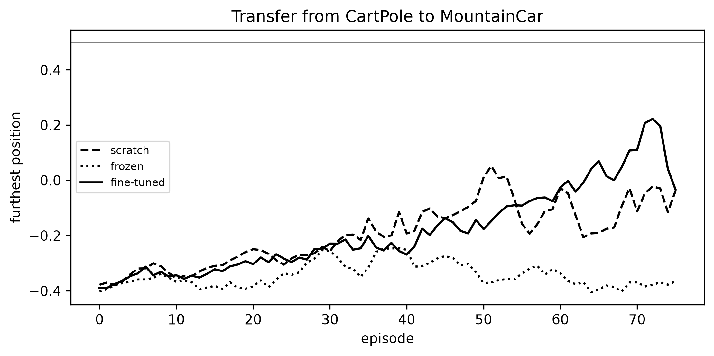

# Experiment 12: Transfer Learning: CartPole to MountainCar

> **File:** `exp12.py`  |  **Tools:** Python 3, NumPy, Matplotlib, PyTorch, Gymnasium

## 🎯 Aim

To demonstrate transfer learning using the CartPole and the MountainCar environments and to compare three ways of using the learnt network.

## 📘 Theory

Transfer learning starts a new task from the knowledge of an old one. In deep learning this means copying the weights of the first layers of a network that was trained on a source task into a network for the target task. There are two ways to continue: the copied layers can be frozen, so that only the new layers are trained, or they can be fine-tuned together with the new layers. Freezing is safe and fast but only works if the old features really suit the new task, while fine-tuning is more flexible.

The source task is CartPole and the target is MountainCar, whose state has 2 numbers and whose actions are 3 (left, nothing, right). To make the network fit, the state of the car is padded with two zeros and a new output layer with three outputs is created, while the two hidden layers of 64 units come from CartPole. MountainCar has no reward until the flag is reached, so a potential-based shaping reward built from the car's energy is added in all three cases. The shaped reward and the potential are:

Three learners are compared on two seeds each: one that starts from scratch, one with the hidden layers copied and frozen, and one with the hidden layers copied and fine-tuned.

- **Frozen layers**: Layers whose weights are not changed during training.
- **Fine-tuning**: Training all layers, starting from the copied weights.
- **Negative transfer**: Old knowledge that hurts the new task.
- **Sparse reward**: Reward that is rarely received, which makes learning hard.

### 📐 Formulas

$$ r' = r + \gamma \Phi \left(s'\right) - \Phi \left(s\right) $$

$$ \Phi \left(x, v\right) = 0.0025 \sin\left(3x\right) + \frac{1}{2}{v}^{2} $$

## 🪜 Algorithm / Steps

1. Train a 4-64-64-2 network on CartPole for 100 episodes.
2. Create three MountainCar learners: scratch, frozen (only the output layer trains) and fine-tuned (all layers train).
3. Train each for 80 episodes of at most 200 steps on two seeds using the shaped reward.
4. Record the first episode with success and the furthest position and plot the curves.

## 💻 Code

```python
import math
import random
from collections import deque

import gymnasium as gym
import matplotlib.pyplot as plt
import numpy as np
import torch
import torch.nn as nn

GAMMA = 0.99


def network(n_out):
    return nn.Sequential(nn.Linear(4, 64), nn.ReLU(), nn.Linear(64, 64), nn.ReLU(), nn.Linear(64, n_out))


def widen(state):
    return torch.tensor(np.concatenate([state, np.zeros(4 - len(state))]), dtype=torch.float32)


def energy(s):
    return 0.0025 * math.sin(3 * s[0]) + 0.5 * s[1] ** 2


class Agent:
    def __init__(self, env_id, net, trainable, seed, shaped):
        self.env, self.net, self.shaped = gym.make(env_id), net, shaped
        self.n = self.env.action_space.n
        self.target = network(self.n)
        self.target.load_state_dict(net.state_dict())
        self.opt = torch.optim.Adam(trainable, lr=1e-3)
        self.memory, self.seed = deque(maxlen=20000), seed
        random.seed(seed)
        torch.manual_seed(seed)

    def learn(self):
        S, A, R, S2, T = zip(*random.sample(self.memory, 64))
        S, S2 = torch.stack(S), torch.stack(S2)
        A, R, T = torch.tensor(A), torch.tensor(R, dtype=torch.float32), torch.tensor(T, dtype=torch.float32)
        q = self.net(S).gather(1, A.view(-1, 1)).squeeze()
        with torch.no_grad():
            y = R + GAMMA * self.target(S2).max(1).values * (1 - T)
        loss = nn.functional.smooth_l1_loss(q, y)
        self.opt.zero_grad()
        loss.backward()
        self.opt.step()

    def episode(self, ep, total_eps, limit=200):
        eps = max(0.05, 1 - ep / (0.5 * total_eps))
        s, _ = self.env.reset(seed=self.seed * 1000 + ep)
        furthest, steps, done, success = -1.2, 0, False, False
        while not done and steps < limit:
            if random.random() < eps:
                a = self.env.action_space.sample()
            else:
                with torch.no_grad():
                    a = int(self.net(widen(s)).argmax())
            s2, r, term, trunc, _ = self.env.step(a)
            done, success = term or trunc, term
            if self.shaped:
                r += 200 * (GAMMA * energy(s2) - energy(s))
            self.memory.append((widen(s), a, r, widen(s2), float(term)))
            furthest, s, steps = max(furthest, s2[0]), s2, steps + 1
            if len(self.memory) >= 64:
                self.learn()
        if ep % 5 == 0:
            self.target.load_state_dict(self.net.state_dict())
        return furthest, steps, success


source = network(2)
agent = Agent("CartPole-v1", source, source.parameters(), seed=5, shaped=False)
stats = [agent.episode(e, 100, limit=300) for e in range(100)]
print("pre-training on CartPole-v1: mean steps in the last 10 episodes =", round(np.mean([x[1] for x in stats[-10:]]), 1))

modes = {"scratch": "all layers trained from random start",
         "frozen": "hidden layers copied and frozen, only the new output layer learns",
         "fine-tuned": "hidden layers copied, every layer keeps learning"}
EPISODES, SEEDS = 80, (11, 12)
curves, success_at = {m: [] for m in modes}, {m: [] for m in modes}
for mode in modes:
    for seed in SEEDS:
        net = network(3)
        if mode != "scratch":
            net.load_state_dict({k: v for k, v in source.state_dict().items() if not k.startswith("4")}, strict=False)
        trainable = list(net[4].parameters()) if mode == "frozen" else list(net.parameters())
        ag = Agent("MountainCar-v0", net, trainable, seed, shaped=True)
        run = [ag.episode(e, EPISODES) for e in range(EPISODES)]
        curves[mode].append([x[0] for x in run])
        success_at[mode].append(next((i + 1 for i, x in enumerate(run) if x[2]), None))

print("\nMountainCar-v0: the car must reach position 0.5 (state padded from 2 to 4 numbers, 3 actions)")
for mode, text in modes.items():
    c = np.array(curves[mode])
    print(f"{mode:<11}| {text}")
    print(f"           first success at episode {success_at[mode]} | furthest position, episodes 1-10: {c[:, :10].mean():.3f}, last 10: {c[:, -10:].mean():.3f}")

plt.figure(figsize=(7.5, 3.8))
for (mode, c), st in zip(curves.items(), ("--", ":", "-")):
    plt.plot(np.convolve(np.mean(c, axis=0), np.ones(5) / 5, mode="valid"), st, color="black", lw=1.6, label=mode)
plt.axhline(0.5, color="grey", lw=0.8)
plt.xlabel("episode"); plt.ylabel("furthest position")
plt.title("Transfer from CartPole to MountainCar")
plt.legend(fontsize=8)
plt.tight_layout()
plt.show()
```

## 🖥️ Output

```text
pre-training on CartPole-v1: mean steps in the last 10 episodes = 227.5

MountainCar-v0: the car must reach position 0.5 (state padded from 2 to 4 numbers, 3 actions)
scratch    | all layers trained from random start
           first success at episode [40, None] | furthest position, episodes 1-10: -0.349, last 10: -0.075
frozen     | hidden layers copied and frozen, only the new output layer learns
           first success at episode [None, None] | furthest position, episodes 1-10: -0.381, last 10: -0.368
fine-tuned | hidden layers copied, every layer keeps learning
           first success at episode [70, None] | furthest position, episodes 1-10: -0.363, last 10: 0.038
```

<p align="center"></p>

## ✅ Result

After pre-training the CartPole network balances the pole for 227.5 steps on average. In MountainCar the scratch learners reach the flag once in two runs (episode 40) and their furthest position improves from −0.349 to −0.075. The frozen network shows no progress at all (−0.381 then −0.368), which means the CartPole features are not useful in MountainCar by themselves. The fine-tuned network reaches the flag once (episode 70) and improves from −0.363 to +0.038, ending the best of the three. So in this small test fine-tuning helped, while freezing hurt, but two seeds are too few to be sure how much of the difference comes from luck.

## 🎤 Viva Questions

**Q. What is transfer learning?**  
A. Using the knowledge from a source task to start learning a target task faster.

**Q. What does freezing layers mean?**  
A. Their weights are not changed during training.

**Q. What is fine-tuning?**  
A. Continuing to train the copied layers on the new task.

**Q. What is reward shaping?**  
A. Adding a helper reward to guide a problem with sparse rewards.

**Q. Why was the MountainCar state padded with zeros?**  
A. So that the 4-input layer copied from CartPole fits the 2 numbers of MountainCar.

---
[⬅ Back to index](README.md)
