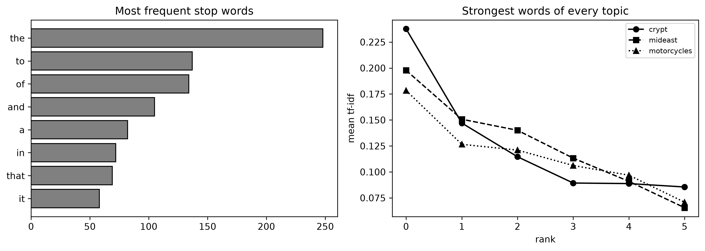

# Experiment 13: Stop Words, TF and IDF on a Newsgroup Corpus

> **File:** `exp13.py`  |  **Tools:** Python 3, NumPy, Matplotlib, scikit-learn

## 🎯 Aim

To select a freely available corpus, count the stop words in every document, find the most frequent ones, and calculate the term frequency and the inverse document frequency to find how important a document is for a query.

## 📘 Theory

A corpus is a collection of documents. In text mining the very common words of a language, the stop words, are usually counted separately because they dominate the word counts without telling much about the content. A frequency table of the stop words shows how much of a text is made of them and which ones are used most.

To judge the importance of a document for a query, the term frequency (how often the word is in the document, relative to its length) is multiplied by the inverse document frequency (how rare the word is in the collection). The smoothed form idf = ln((1 + N)/(1 + df)) + 1 that is used in many libraries never becomes zero, so very common words still keep a small weight. Each document and the query are then turned into tf-idf vectors and compared with the cosine similarity, which measures the angle between them and does not depend on their length. The formulas of the basic version are:

- **Corpus**: Collection of text documents.
- **Smoothed idf**: idf with 1 added to numerator, denominator and result so that it is never zero.
- **Cosine similarity**: Angle based similarity of two vectors, from 0 to 1 for tf-idf.
- **Vocabulary**: The list of different words in the corpus.

### 📐 Formulas

$$ tf\left(t, d\right) = \frac{count of t in d}{words in d} $$

$$ idf\left(t\right) = \ln \frac{N}{df\left(t\right)} $$

$$ tf-idf\left(t, d\right) = tf\left(t, d\right) \times idf\left(t\right) $$

## 🪜 Algorithm / Steps

1. Load three topics of 20 Newsgroups (motorcycles, cryptography and Middle East politics) and keep 8 posts of each.
2. Build the vocabulary and the word-count matrix by hand with Counter and NumPy.
3. Find the share of stop words for every topic and the frequent stop words with the number of documents containing them.
4. Calculate tf, the smoothed idf and the normalised tf-idf, and rank the documents for three queries by cosine similarity.
5. List the strongest words of every topic with and without the stop words.

## 💻 Code

```python
import math
import re
from collections import Counter

import matplotlib.pyplot as plt
import numpy as np
from sklearn.datasets import fetch_20newsgroups
from sklearn.feature_extraction.text import ENGLISH_STOP_WORDS

cats = ["rec.motorcycles", "sci.crypt", "talk.politics.mideast"]
raw = fetch_20newsgroups(subset="train", categories=cats, remove=("headers", "footers", "quotes"))
docs, label = [], []
for c in range(len(cats)):
    chosen = [d for d, t in zip(raw.data, raw.target) if t == c and 100 < len(d.split()) < 400][:8]
    docs += chosen
    label += [raw.target_names[c].split(".")[-1]] * len(chosen)
print(f"{len(docs)} documents, 8 for each of {raw.target_names}")

words = [re.findall(r"[a-z]+(?:'[a-z]+)?", d.lower()) for d in docs]
vocab = sorted({w for ws in words for w in ws})
index = {w: i for i, w in enumerate(vocab)}
N, V = len(docs), len(vocab)
print("vocabulary size:", V, "| tokens:", sum(map(len, words)))

counts = np.zeros((N, V))
for i, ws in enumerate(words):
    for w, c in Counter(ws).items():
        counts[i, index[w]] = c

stop = np.array([w in ENGLISH_STOP_WORDS for w in vocab])
stop_tokens = counts[:, stop].sum(axis=1)
print("\nshare of stop words in the text of each topic")
for c in sorted(set(label)):
    rows = [i for i in range(N) if label[i] == c]
    print(f"  {c:<12} {100 * stop_tokens[rows].sum() / counts[rows].sum():5.1f} %")
overall = counts[:, stop].sum(axis=0)
order = np.argsort(-overall)[:8]
print("\nfrequent stop words, corpus total and number of documents that contain them")
for j in order:
    print(f"  {np.array(vocab)[stop][j]:<6} {int(overall[j]):>4} times in {int((counts[:, stop][:, j] > 0).sum()):>2} of {N} documents")

tf = counts / counts.sum(axis=1, keepdims=True)
df = (counts > 0).sum(axis=0)
idf = np.log((1 + N) / (1 + df)) + 1
tfidf = tf * idf
tfidf /= np.linalg.norm(tfidf, axis=1, keepdims=True)
print("\nsmoothed idf = ln((1 + N) / (1 + df)) + 1")
for w in ("the", "and", "bike", "key", "israel"):
    print(f"  {w:<7} df = {int(df[index[w]]):>2}  idf = {idf[index[w]]:.3f}")

print("\ndocuments ranked by cosine similarity with the tf-idf vector of the query")
for q in ("engine ride motorcycle helmet", "encryption key algorithm", "israel arab peace war"):
    qv = np.zeros(V)
    for w in re.findall(r"[a-z]+(?:'[a-z]+)?", q):
        if w in index:
            qv[index[w]] = idf[index[w]] / len(q.split())
    qv /= np.linalg.norm(qv)
    sims = tfidf @ qv
    top = np.argsort(-sims)[:3]
    print(f"  '{q}': {[(int(i) + 1, label[i], round(float(sims[i]), 3)) for i in top]}")

fig, ax = plt.subplots(1, 2, figsize=(11, 4))
ax[0].barh(np.array(vocab)[stop][order][::-1], overall[order][::-1], color="grey", edgecolor="black")
ax[0].set_title("Most frequent stop words")
for c, st in zip(sorted(set(label)), ("o-", "s--", "^:")):
    rows = [i for i in range(N) if label[i] == c]
    mean = tfidf[rows].mean(axis=0)
    top = np.argsort(-mean)[:6]
    ax[1].plot(mean[top], st, color="black", label=c)
    content = np.where(~stop)[0]
    best = content[np.argsort(-mean[content])[:6]]
    print(f"top tf-idf words of {c:<12} with stop words: {', '.join(np.array(vocab)[top])}")
    print(f"{'':<27}{c:<12} without stop words: {', '.join(np.array(vocab)[best])}")
ax[1].set_xlabel("rank"); ax[1].set_ylabel("mean tf-idf"); ax[1].legend(fontsize=8); ax[1].set_title("Strongest words of every topic")
plt.tight_layout()
plt.show()
```

## 🖥️ Output

```text
24 documents, 8 for each of ['rec.motorcycles', 'sci.crypt', 'talk.politics.mideast']
vocabulary size: 1492 | tokens: 4329

share of stop words in the text of each topic
  crypt         55.8 %
  mideast       49.7 %
  motorcycles   54.0 %

frequent stop words, corpus total and number of documents that contain them
  the     248 times in 24 of 24 documents
  to      137 times in 24 of 24 documents
  of      134 times in 22 of 24 documents
  and     105 times in 23 of 24 documents
  a        82 times in 22 of 24 documents
  in       72 times in 22 of 24 documents
  that     69 times in 23 of 24 documents
  it       58 times in 21 of 24 documents

smoothed idf = ln((1 + N) / (1 + df)) + 1
  the     df = 24  idf = 1.000
  and     df = 23  idf = 1.041
  bike    df =  2  idf = 3.120
  key     df =  4  idf = 2.609
  israel  df =  3  idf = 2.833

documents ranked by cosine similarity with the tf-idf vector of the query
  'engine ride motorcycle helmet': [(1, 'motorcycles', 0.152), (6, 'motorcycles', 0.063), (7, 'motorcycles', 0.04)]
  'encryption key algorithm': [(15, 'crypt', 0.09), (14, 'crypt', 0.068), (13, 'crypt', 0.054)]
  'israel arab peace war': [(21, 'mideast', 0.16), (24, 'mideast', 0.159), (23, 'mideast', 0.067)]
top tf-idf words of crypt        with stop words: the, of, to, a, and, is
                           crypt        without stop words: s, government, judge, legal, sound, cryptography
top tf-idf words of mideast      with stop words: the, of, to, and, in, for
                           mideast      without stop words: posts, nazi, armenians, turkish, israel, article
top tf-idf words of motorcycles  with stop words: the, a, to, that, i, you
                           motorcycles  without stop words: car, i'm, bike, countersteering, mike, ignorant
```

<p align="center"></p>

## ✅ Result

The 24 posts have 4329 words and a vocabulary of 1492 different words. Stop words make up 55.8 % of the cryptography posts, 54.0 % of the motorcycle posts and 49.7 % of the Middle East posts; 'the' is in all 24 documents (248 times), 'to' also (137), and 'of' and 'and' in 22 and 23 of them. Their idf is only 1.000 to 1.041, while the rarer words bike, key and israel have 3.120, 2.609 and 2.833. In every query the best three documents belong to the right topic (for 'encryption key algorithm' all from crypt, similarity up to 0.090). The strongest tf-idf words of each topic are stop words unless they are removed first; after removing them the topic words appear (bike and countersteering, israel and armenians, government and cryptography).

## 🎤 Viva Questions

**Q. What are stop words?**  
A. Very common words such as the, of and and that carry little content.

**Q. What is term frequency?**  
A. The share of the words of a document that are the term.

**Q. What is inverse document frequency?**  
A. The logarithm of the number of documents divided by the number of documents that contain the term.

**Q. What does tf-idf show?**  
A. How important a word is to a document in a collection.

**Q. Why is the idf of 'the' near zero?**  
A. Because it occurs in almost every document.

---
[⬅ Back to index](README.md)
