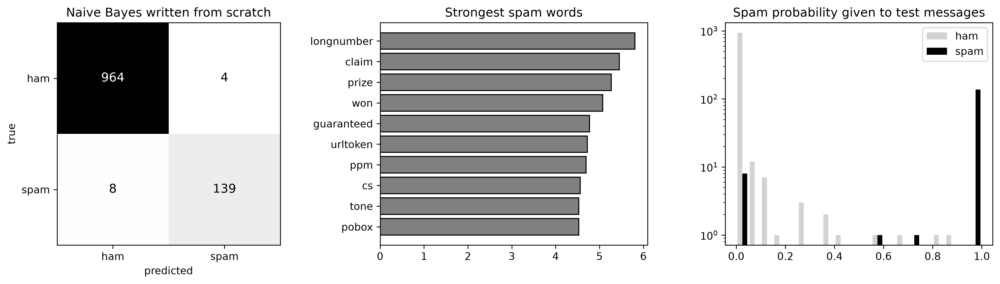

# Experiment 14: Spam Filter using a Naive Bayes Classifier written from Scratch

> **File:** `exp14.py`  |  **Tools:** Python 3, NumPy, Matplotlib

## 🎯 Aim

To write the Python code to develop a spam filter using NLP, with the classifier written from scratch.

## 📘 Theory

The Naive Bayes classifier applies Bayes' theorem. The probability that a message is spam is proportional to the prior probability of spam multiplied by the probability of each word of the message given spam, under the naive assumption that the words are independent. To count a word that never appeared in a class, Laplace smoothing adds 1 to every count so that no probability is zero. To avoid multiplying many small numbers, the logarithms are added instead. The rule is:

The text is first cleaned: it is changed to lower case, web addresses are replaced by the token urltoken, money amounts by moneytoken, long digit strings (such as phone numbers) by longnumber, and other numbers by number. These special tokens are useful because spammers use them a lot. Training counts, for every word, the number of messages of each class that contain it. The SMS Spam Collection of 5574 messages is split 80:20 at random.

A spam filter must avoid blocking real messages, so the decision threshold is studied too: a higher threshold blocks fewer real messages, at the cost of missing some spam.

- **Laplace smoothing**: Adding 1 to all counts so that unseen words do not give probability zero.
- **Log probability**: Logarithms are added instead of multiplying small probabilities.
- **Prior**: Share of each class in the training data.
- **Threshold**: Spam probability above which a message is blocked.

### 📐 Formulas

$$ P\left(spam | w\right) \propto P\left(spam\right){\prod }_{i} P\left({w}_{i} | spam\right) $$

$$ score = \log P\left(c\right) + \sum_{i} \log \frac{{n}_{ic} + 1}{{N}_{c} + V} $$

## 🪜 Algorithm / Steps

1. Read the data and write clean() to lower-case the text and replace URLs, money, long numbers and numbers by tokens.
2. Split the messages 80:20 and count, for every word, the messages of each class that contain it.
3. Write spam_probability() from the priors and the smoothed word likelihoods, using logarithms.
4. Calculate the confusion matrix, accuracy, precision, recall and F1 on the test messages.
5. List the strongest words, study the threshold and classify new messages.

## 💻 Code

```python
import math
import re
from collections import Counter

import matplotlib.pyplot as plt
import numpy as np

lines = [l.rstrip("\n").split("\t", 1) for l in open("data/SMSSpamCollection", encoding="utf-8", errors="ignore")]
labels = np.array([1 if a == "spam" else 0 for a, _ in lines])
texts = [b for _, b in lines]
print("messages:", len(texts), "| spam:", int(labels.sum()), "| ham:", int((1 - labels).sum()))


def clean(t):
    t = t.lower()
    t = re.sub(r"(https?://\S+|www\.\S+)", " urltoken ", t)
    t = re.sub(r"[£$]\s?\d+[\d,.]*", " moneytoken ", t)
    t = re.sub(r"\d{5,}", " longnumber ", t)
    t = re.sub(r"\d+", " number ", t)
    return re.findall(r"[a-z']+", t)


rng = np.random.default_rng(14)
order = rng.permutation(len(texts))
cut = int(0.8 * len(texts))
train, test = order[:cut], order[cut:]

word_counts = [Counter(), Counter()]
docs = [0, 0]
for i in train:
    word_counts[labels[i]].update(set(clean(texts[i])))
    docs[labels[i]] += 1
vocab = set(word_counts[0]) | set(word_counts[1])
V = len(vocab)
total = [sum(word_counts[c].values()) for c in (0, 1)]
prior = [math.log(docs[c] / sum(docs)) for c in (0, 1)]
print(f"training messages: {len(train)} (spam {docs[1]}, ham {docs[0]}) | vocabulary: {V} words")


def log_likelihood(word, c, alpha=1.0):
    return math.log((word_counts[c][word] + alpha) / (total[c] + alpha * V))


def spam_probability(text):
    ws = [w for w in set(clean(text)) if w in vocab]
    s = [prior[c] + sum(log_likelihood(w, c) for w in ws) for c in (0, 1)]
    m = max(s)
    e = [math.exp(x - m) for x in s]
    return e[1] / sum(e)


probs = np.array([spam_probability(texts[i]) for i in test])
pred = (probs > 0.5).astype(int)
y = labels[test]
tp, fp, fn, tn = int(((pred == 1) & (y == 1)).sum()), int(((pred == 1) & (y == 0)).sum()), int(((pred == 0) & (y == 1)).sum()), int(((pred == 0) & (y == 0)).sum())
precision, recall = tp / (tp + fp), tp / (tp + fn)
print(f"\ntest messages: {len(test)}")
print(f"true spam caught {tp}, spam missed {fn}, ham marked as spam {fp}, ham passed {tn}")
print(f"accuracy {100 * (tp + tn) / len(test):.2f} % | precision {precision:.3f} | recall {recall:.3f} | F1 {2 * precision * recall / (precision + recall):.3f}")
print(f"a filter that calls everything ham would be {100 * (1 - y.mean()):.1f} % accurate, so accuracy alone is not enough")

ratio = {w: log_likelihood(w, 1) - log_likelihood(w, 0) for w in vocab if word_counts[0][w] + word_counts[1][w] >= 8}
ranked = sorted(ratio, key=ratio.get)
print("\nstrongest spam words:", ", ".join(ranked[::-1][:10]))
print("strongest ham words :", ", ".join(ranked[:10]))

print("\nthreshold study (how many ham messages are wrongly blocked for a given spam recall)")
for th in (0.5, 0.9, 0.99, 0.999):
    p = (probs > th).astype(int)
    print(f"  threshold {th:<6} recall {((p == 1) & (y == 1)).sum() / (y == 1).sum():.3f}  ham blocked {int(((p == 1) & (y == 0)).sum())}")

samples = ["Winner! You have been selected for a 1000 pound prize, call 09061701461 to claim",
           "Hey, are you coming to the lab tomorrow? bring the file",
           "FREE entry to our weekly competition, text WIN to 80086 now",
           "I will call you after dinner, save some food for me"]
print("\nnew messages")
for t in samples:
    p = spam_probability(t)
    print(f"  {'SPAM' if p > 0.5 else 'ham ':<4} {p:.3f}  {t[:64]}")

fig, ax = plt.subplots(1, 3, figsize=(14, 4))
ax[0].imshow([[tn, fp], [fn, tp]], cmap="Greys")
for (i, j), v in np.ndenumerate([[tn, fp], [fn, tp]]):
    ax[0].text(j, i, v, ha="center", va="center", color="white" if v > 500 else "black", fontsize=12)
ax[0].set_xticks([0, 1]); ax[0].set_xticklabels(["ham", "spam"]); ax[0].set_yticks([0, 1]); ax[0].set_yticklabels(["ham", "spam"])
ax[0].set_xlabel("predicted"); ax[0].set_ylabel("true"); ax[0].set_title("Naive Bayes written from scratch")
top = ranked[::-1][:10]
ax[1].barh(top[::-1], [ratio[w] for w in top[::-1]], color="grey", edgecolor="black"); ax[1].set_title("Strongest spam words")
ax[2].hist([probs[y == 0], probs[y == 1]], bins=20, color=["lightgrey", "black"], label=["ham", "spam"])
ax[2].set_yscale("log"); ax[2].set_title("Spam probability given to test messages"); ax[2].legend()
plt.tight_layout()
plt.show()
```

## 🖥️ Output

```text
messages: 5574 | spam: 747 | ham: 4827
training messages: 4459 (spam 600, ham 3859) | vocabulary: 7016 words

test messages: 1115
true spam caught 139, spam missed 8, ham marked as spam 4, ham passed 964
accuracy 98.92 % | precision 0.972 | recall 0.946 | F1 0.959
a filter that calls everything ham would be 86.8 % accurate, so accuracy alone is not enough

strongest spam words: longnumber, claim, prize, won, guaranteed, urltoken, ppm, cs, tone, pobox
strongest ham words : lt, gt, i'll, lor, he, later, da, she, wat, already

threshold study (how many ham messages are wrongly blocked for a given spam recall)
  threshold 0.5    recall 0.946  ham blocked 4
  threshold 0.9    recall 0.932  ham blocked 0
  threshold 0.99   recall 0.925  ham blocked 0
  threshold 0.999  recall 0.878  ham blocked 0

new messages
  SPAM 1.000  Winner! You have been selected for a 1000 pound prize, call 0906
  ham  0.000  Hey, are you coming to the lab tomorrow? bring the file
  SPAM 1.000  FREE entry to our weekly competition, text WIN to 80086 now
  ham  0.000  I will call you after dinner, save some food for me
```

<p align="center"></p>

## ✅ Result

The training set has 4459 messages (600 spam) and a vocabulary of 7016 words. On the 1115 test messages the filter catches 139 spam messages, misses 8, blocks 4 real messages and passes 964: accuracy 98.92 %, precision 0.972, recall 0.946 and F1 0.959. A filter that calls everything ham would already be 86.8 % accurate, which is why precision and recall are needed. The strongest spam words are longnumber, claim, prize, won and guaranteed, and the strongest ham words lt, gt, i'll, lor and later. Raising the threshold to 0.9 blocks no real message at all while the recall drops only from 0.946 to 0.932. The four new test messages were classified correctly.

## 🎤 Viva Questions

**Q. What is a spam filter?**  
A. A classifier that labels a message as spam or ham.

**Q. How does Naive Bayes work?**  
A. It multiplies the prior with the word probabilities of each class, assuming independent words, and picks the larger.

**Q. What are precision and recall?**  
A. Precision is the share of blocked messages that are spam; recall is the share of spam that is blocked.

**Q. Why is accuracy alone misleading here?**  
A. Only about 13 % of the messages are spam, so calling everything ham is already 87 % accurate.

**Q. What is Laplace smoothing?**  
A. Adding 1 to the counts so that unseen words do not give probability zero.

---
[⬅ Back to index](README.md)
