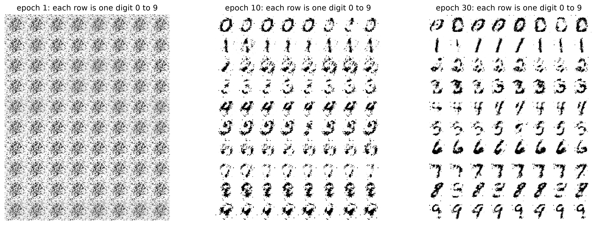

# Experiment 15: Conditional GAN: Generating Handwritten Digits on Demand

> **File:** `exp15.py`  |  **Tools:** Python 3, NumPy, Matplotlib, PyTorch, Keras (data loader)

## 🎯 Aim

To demonstrate one application of a generative adversarial network: a conditional GAN that generates the handwritten digit that is asked for.

## 📘 Theory

In a generative adversarial network two networks play a game. The generator makes fake samples from random noise, and the discriminator tries to tell the fake samples from the real ones. The generator is rewarded when it fools the discriminator, and the discriminator when it catches the fakes. At the equilibrium the fakes look like real data. The game is described below.

A conditional GAN gives both networks an extra input, here the digit label. The label is turned into a vector of 16 numbers by an embedding layer and joined to the noise of the generator and to the image seen by the discriminator. After training, the generator can be asked for a particular digit by choosing the label, which makes the GAN more useful than one that produces random digits.

GAN training is unstable. The discriminator can become so strong that the generator gets no useful signal; this happened in a first run of this experiment (discriminator loss 0.000). It was fixed with three standard measures: the discriminator learns more slowly (learning rate 0.00008), the target for real images is 0.9 instead of 1 (label smoothing), and a little noise is added to the images that the discriminator sees, which is reduced to zero over 20 epochs.

- **Conditional GAN**: GAN in which a label is given to both networks to control the output.
- **Embedding**: Learned vector that represents a label.
- **Label smoothing**: Using a target of 0.9 instead of 1 so that the discriminator is not over-confident.
- **Instance noise**: Small noise added to the inputs of the discriminator to stabilise training.

### 📐 Formulas

$$ \min_{G}\max_{D} {E}_{x}\left(\log D\left(x\right)\right) + {E}_{z}\left(\log\left(1 - D\left(G\left(z\right)\right)\right)\right) $$

## 🪜 Algorithm / Steps

1. Load MNIST and scale the images to −1 to 1.
2. Build the generator (noise 48 + label 16 → 256 → 512 → 784) and the discriminator (image 784 + label 16 → 512 → 256 → 1).
3. Train for 30 epochs: the discriminator on real and fake pairs, then the generator.
4. If the discriminator wins completely, make it slower and add label smoothing and noise.
5. Generate 8 images of every digit after epochs 1, 10 and 30.

## 💻 Code

```python
import os
os.environ["TF_CPP_MIN_LOG_LEVEL"] = "3"
import time

import keras
import matplotlib.pyplot as plt
import numpy as np
import torch
import torch.nn as nn

torch.manual_seed(31)
(xtr, ytr), _ = keras.datasets.mnist.load_data()
X = torch.tensor(xtr.reshape(-1, 784) / 127.5 - 1.0, dtype=torch.float32)
Y = torch.tensor(ytr).long()
print("training images:", tuple(X.shape), "| labels 0-9 are given to both networks (conditional GAN)")

ZDIM = 48


class Generator(nn.Module):
    def __init__(self):
        super().__init__()
        self.label = nn.Embedding(10, 16)
        self.net = nn.Sequential(nn.Linear(ZDIM + 16, 256), nn.ReLU(), nn.Linear(256, 512), nn.ReLU(), nn.Linear(512, 784), nn.Tanh())

    def forward(self, z, y):
        return self.net(torch.cat([z, self.label(y)], dim=1))


class Discriminator(nn.Module):
    def __init__(self):
        super().__init__()
        self.label = nn.Embedding(10, 16)
        self.net = nn.Sequential(nn.Linear(784 + 16, 512), nn.LeakyReLU(0.2), nn.Dropout(0.3), nn.Linear(512, 256), nn.LeakyReLU(0.2), nn.Dropout(0.3), nn.Linear(256, 1))

    def forward(self, x, y):
        return self.net(torch.cat([x, self.label(y)], dim=1))


G, D = Generator(), Discriminator()
og = torch.optim.Adam(G.parameters(), lr=2e-4, betas=(0.5, 0.999))
od = torch.optim.Adam(D.parameters(), lr=8e-5, betas=(0.5, 0.999))
loss_fn = nn.BCEWithLogitsLoss()
print("parameters: generator", sum(p.numel() for p in G.parameters()), "| discriminator", sum(p.numel() for p in D.parameters()))

fixed_z = torch.randn(80, ZDIM)
fixed_y = torch.arange(10).repeat_interleave(8)
history, shots, t0 = [], {}, time.time()
for ep in range(1, 31):
    perm = torch.randperm(len(X))
    for i in range(0, len(perm) - 127, 128):
        idx = perm[i:i + 128]
        real, ry = X[idx], Y[idx]
        fy = torch.randint(0, 10, (len(idx),))
        fake = G(torch.randn(len(idx), ZDIM), fy)
        noise = 0.1 * max(0.0, 1 - ep / 20)
        ld = loss_fn(D(real + noise * torch.randn_like(real), ry), torch.full((len(idx), 1), 0.9)) + loss_fn(D(fake.detach() + noise * torch.randn_like(fake), fy), torch.zeros(len(idx), 1))
        od.zero_grad(); ld.backward(); od.step()
        lg = loss_fn(D(fake, fy), torch.ones(len(idx), 1))
        og.zero_grad(); lg.backward(); og.step()
    history.append((ld.item(), lg.item()))
    if ep in (1, 10, 30):
        with torch.no_grad():
            shots[ep] = G(fixed_z, fixed_y).view(10, 8, 28, 28).numpy()
    if ep % 5 == 0 or ep == 1:
        print(f"epoch {ep:>2}  discriminator loss {ld.item():.3f}  generator loss {lg.item():.3f}  ({time.time() - t0:.0f} s)")

with torch.no_grad():
    G.eval()
    D.eval()
    z = torch.randn(1000, ZDIM)
    y = torch.randint(0, 10, (1000,))
    fake_scores = torch.sigmoid(D(G(z, y), y)).mean().item()
    real_scores = torch.sigmoid(D(X[:1000], Y[:1000])).mean().item()
print(f"\ndiscriminator confidence that an image is real: real images {real_scores:.2f}, generated images {fake_scores:.2f}")

fig, ax = plt.subplots(1, 3, figsize=(14, 5))
for a, (ep, g) in zip(ax, shots.items()):
    a.imshow(np.vstack([np.hstack(g[r]) for r in range(10)]), cmap="Greys")
    a.set_title(f"epoch {ep}: each row is one digit 0 to 9"); a.axis("off")
plt.tight_layout()
plt.show()
```

## 🖥️ Output

```text
training images: (60000, 784) | labels 0-9 are given to both networks (conditional GAN)
parameters: generator 550576 | discriminator 541857
epoch  1  discriminator loss 1.026  generator loss 1.472  (3 s)
epoch  5  discriminator loss 0.798  generator loss 2.114  (16 s)
epoch 10  discriminator loss 0.710  generator loss 2.434  (32 s)
epoch 15  discriminator loss 0.851  generator loss 2.002  (48 s)
epoch 20  discriminator loss 0.999  generator loss 2.800  (64 s)
epoch 25  discriminator loss 0.875  generator loss 1.923  (79 s)
epoch 30  discriminator loss 1.016  generator loss 1.714  (94 s)

discriminator confidence that an image is real: real images 0.66, generated images 0.21
```

<p align="center"></p>

## ✅ Result

The generator has 550576 parameters and the discriminator 541857. The first run, without the stabilising measures, failed: the discriminator loss fell to 0.000 and the generator loss rose to about 12, so nothing useful was learnt. With the measures the losses stay in a healthy range (discriminator about 0.7 to 1.0, generator about 1.7 to 2.8). At the end the discriminator gives 0.66 to real images and 0.21 to generated ones. The grid after epoch 30 shows a row of eight images for every digit from 0 to 9. The rows for 0, 1, 4, 6 and 9 are clearly the asked digit, 5 and 7 are readable, while 2, 3 and 8 are still messy, and the images inside a row are rather similar, so the variety is limited. The grid after epoch 1 is only noise.

## 🎤 Viva Questions

**Q. What are the two networks of a GAN?**  
A. The generator, which makes fake samples, and the discriminator, which tells real from fake.

**Q. How does the training work?**  
A. The two networks compete: the generator tries to fool the discriminator and the discriminator tries to catch the fakes.

**Q. What is mode collapse?**  
A. The generator produces only a few kinds of samples.

**Q. Why is GAN training unstable?**  
A. If one network becomes much stronger than the other, the weaker one gets no useful learning signal.

**Q. What is a conditional GAN or an application of a GAN?**  
A. A GAN that gets a label as input, so a chosen class can be generated; GANs are used for image generation and data augmentation.

---
[⬅ Back to index](README.md)
